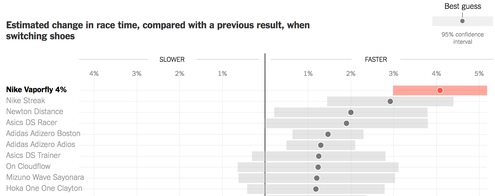

```{r setup, include = FALSE}
library(tidyverse) # Add the tidyverse package to my current library.
library(haven) # Handle labelled data.
library(essurvey) # Add ESS API package to library.
library(Hmisc) # Weighted statistics.

options(width = 115, digits = 3)
```

```{r include = FALSE, eval = FALSE}
# Import the ESS round 9 data via the API
ESS <- import_rounds(rounds = 9, ess_email = "merlin.schaeffer@uni-koeln.de", format = "spss")
```

<!-- Note: original sli.do interactive polling iframe dropped here -->

## The final pieces of ggplot2's grammar

```{r, eval = FALSE, error = TRUE}
# A general template
ggplot(data = <DATA>) +         # Create a coordinate system for <DATA>, and add "+"
  <GEOM_FUNCTION>(              # a layer of (geometric) information, which
     mapping = aes(<MAPPINGS>), # maps our data to aestetics, and 
     stat = <STAT>,             # may depend on statistical transformations. 
     position = <POSITION>      # Positioning may be adjusted. 
  ) +
  <COORDINATE_FUNCTION> +       # Change the default coordinate system. 
  <FACET_FUNCTION>              # Draw sub-plots by categorical variables. 
```

::: {.centered}
::: {.note}
*Source*: Wickham & Grolemund ["R for Data Science"](http://r4ds.had.co.nz/data-visualisation.html)
:::
:::

---

## Let's get ready

```{r}
# Add packages to library
library(tidyverse) # Add the tidyverse package to my current library.
library(haven) # Handle labelled data.
library(essurvey) # Add ESS API package to library.
library(ggplot2) # Allows us to create nice figures.
library(Hmisc) # Weighted statistics.
```

---

## Let's get ready

```{r eval = FALSE}
# Import the ESS round 9 data via the API
ESS <- import_rounds(rounds = 9, ess_email = "YOUR-EMAIL", format = "spss")
```

```{r eval = FALSE}
ESS <- ESS %>% # Import the ESS, then (pipe result into)
  transmute( # Create new variables and keep only those
    cntry = as_factor(cntry), # Country of interview
    gndr = as_factor(gndr),
    facntr = as_factor(facntr), # Father born in cntry
    mocntr = as_factor(mocntr), # Mother born in cntry
    dscrgrp = as_factor(dscrgrp), # Belonging to discriminated group
    dscrrlg = as_factor(dscrrlg), # Discriminated because of religion
    rel_discr = case_when(
      dscrgrp == "Yes" & dscrrlg == "Marked" ~ "Yes",
      dscrgrp == "No" | (dscrgrp == "Yes" & dscrrlg != "Marked") ~ "No",
      TRUE ~ as.character(NA)) %>% as_factor(), # all others missing, then change to factor
    pspwght = zap_label(pspwght),
    eduyrs = case_when( # Education
      eduyrs > 21 ~ 21, # Recode to max 21 years of edu.
      eduyrs < 9 ~ 9, # Recode to min 9 years of edu.
      TRUE ~ zap_labels(eduyrs)), # Make it numeric
    atchctr = zap_labels(atchctr)) %>% # Emotionally attached to cntry, then  
  dplyr::filter(# Keep only respondents of immigrant origin,
    facntr == "No" & mocntr == "No",
    # filter cases from four countries
    cntry == "Denmark" | cntry == "Germany" | cntry == "Sweden" | cntry == "Norway")
```

## **Position adjustments** — bar charts

If we want experienced discrimination by country and distinguished by color, ggplot2 estimates separate bars and, by default, *positions* them on top of each other. The result is a so-called "Stacked bar chart".

::: columns
::: {.column width="50%"}
```{r out.width='100%', fig.height = 3.6, fig.width = 7.2, eval = FALSE}
ggplot(data = ESS) +
  geom_bar(aes(x = rel_discr, weight = pspwght,
               fill = cntry)) + 
  labs(x = "Belong to discriminated religious minority") 
```
:::

::: {.column width="50%"}
```{r out.width='100%', fig.height = 3.6, fig.width = 7.2, eval = FALSE}
ggplot(data = ESS) +
  geom_bar(aes(x = rel_discr, weight = pspwght,
               fill = cntry), position = "stack") + 
  labs(x = "Belong to discriminated religious minority") 
```
:::
:::

---

## Position adjustments — bar charts

Where the bars are located is controlled by the `position` argument, with its default `position = "stack"`; alternatives to `"stack"` are: `"dodge"` and `"fill"`.

::: columns
::: {.column width="50%"}
```{r out.width='100%', fig.height = 3.6, fig.width = 7.2, eval = FALSE}
ggplot(data = ESS) +
  geom_bar(aes(x = rel_discr, weight = pspwght,
               fill = cntry), position = "dodge") + 
  labs(x = "Belong to discriminated religious minority") 
```
:::

::: {.column width="50%"}
```{r out.width='100%', fig.height = 3.6, fig.width = 7.2, eval = FALSE}
ggplot(data = ESS) +
  geom_bar(aes(x = rel_discr, weight = pspwght, 
               fill = cntry), position = "fill") + 
  labs(x = "Belong to discriminated religious minority") 
```
:::
:::

---

## Position adjustments — scatter plots

You can change the positioning with the `position` argument. For scatter plots, the default is `"identity"` (basically means: "leave as is"), or `"jitter"` (add random noise).

::: {.note}
Alternatively you can use `geom_jitter()`, which has options `width` and `height` that allow you to control the amount of jittering in % of the respective y and x variables.
:::

::: columns
::: {.column width="50%"}
```{r out.width='90%', fig.height = 3.6, fig.width = 7.2, eval = FALSE}
ggplot(data = ESS, 
       mapping = aes(y = atchctr, x = eduyrs)) +
  geom_point(position = "identity") + 
  labs(y = "Emotionally attached to country",
       x = "Years of education")
```
:::

::: {.column width="50%"}
```{r out.width='90%', fig.height = 3.6, fig.width = 7.2, eval = FALSE}
ggplot(data = ESS, 
       mapping = aes(y = atchctr, x = eduyrs)) +
  geom_point(position = "jitter") + 
  labs(y = "Emotionally attached to country",
       x = "Years of education")
```
:::
:::

---

## Position adjustments — scatter plots

Like the transparency controlled by `alpha`, and using hollow shapes, `position = "jitter"` helps to see patterns in large data sets.

::: columns
::: {.column width="50%"}
```{r out.width='100%', fig.height = 3.6, fig.width = 7.2, eval = FALSE}
ggplot(data = ESS, 
       mapping = aes(y = atchctr, x = eduyrs)) +
  geom_point(position = "identity", alpha = 1/5) + 
  labs(y = "Emotionally attached to country",
       x = "Years of education")
```
:::

::: {.column width="50%"}
```{r out.width='100%', fig.height = 3.6, fig.width = 7.2, eval = FALSE}
ggplot(data = ESS, 
       mapping = aes(y = atchctr, x = eduyrs)) +
  geom_point(position = "jitter", alpha = 1/4) + 
  labs(y = "Emotionally attached to country",
       x = "Years of education")
```
:::
:::

---

## **Statistical transformations**

Scatter plots are rather unique, in that they show the "raw" data.

```{r out.width='60%', fig.height = 3.6, fig.width = 7.2, eval = FALSE}
ggplot(data = ESS, mapping = aes(y = atchctr, x = eduyrs)) +
  geom_point(alpha = 1/20) +
  labs(y = "Emotionally attached to country",
       x = "Years of education")
```

---

## **Statistical transformations**

Most figures rather visualize *statistically-transformed data*, here the count per category.

::: columns
::: {.column width="50%"}
```{r out.width='100%', fig.height = 3.6, fig.width = 7.2, eval = FALSE}
ggplot(data = ESS) +
  # Add layer of bars showing
  # count of discrimination.
  geom_bar(mapping = aes(x = rel_discr, 
                         weight = pspwght)) + 
  labs(x = "Belong to discr. religious minority")
```
:::

::: {.column width="50%"}
```{r eval = FALSE}
# Frequency/count table of experienced discrimination.
table(ESS$rel_discr, useNA = "always") 
```
:::
:::

---

## ggplot2's statistical transformations 

{width="90%"}

::: {.centered}
::: {.note}
*Source*: [Wickham & Grolemund: "R for Data Science"](http://r4ds.had.co.nz/data-visualisation.html)
:::
:::

---

## Statistical transformations

Geoms have a default `stat` function, which performs the transformation, such as counting.

::: {.note}
Vice versa, stats have default geom functions. Chapter 3 of [R for Data Science](http://r4ds.had.co.nz/data-visualisation.html) explains how you build graphs based on stats rather than geoms.
:::

::: columns
::: {.column width="50%"}
```{r out.width='95%', fig.height = 3.6, fig.width = 7.2, eval = FALSE}
ggplot(data = ESS) +
  # Add layer of bars showing count of discr.  
  geom_bar(mapping = aes(x = rel_discr, 
                         weight = pspwght)) +
  
  labs(x = "Belong to discr. religious minority")
```
:::

::: {.column width="50%"}
```{r out.width='95%', fig.height = 3.6, fig.width = 7.2, eval = FALSE}
ggplot(data = ESS) +
  # The default of geom_bar is stat = "count"s
  geom_bar(mapping = aes(x = rel_discr,
                         weight = pspwght), 
           stat = "count") + 
  labs(x = "Belong to discr. religious minority")
```
:::
:::

---

## Statistical transformations — **Like a pro** ...

Oftentimes, we want to do statistical transformations by hand and plot the resulting data.

```{r eval = FALSE}
ESS_cntry <- ESS %>% # use the ESS, then
  mutate( # Generate a numeric 0/1 indicator of perceived discrimination.
    rel_discr_num = case_when(rel_discr == "Yes" ~ 1, 
                              rel_discr == "No" ~ 0,
                              TRUE ~ as.numeric(NA))) %>%
  group_by(cntry) %>% # group ESS_minority by cntry, then
  dplyr::summarize( # Start summarize function.
    wn = sum(pspwght, na.rm = TRUE), # weighted number of cases,
    df = (wn^2 / sum(pspwght^2, na.rm = TRUE)), # degrees of freedom,
    wn_rd = sum(rel_discr_num * pspwght, na.rm = TRUE), # weighted number of cases who ...,
    wperc_rd = (wn_rd / wn) * 100, # weighted % who ...,
    wse_rd = sqrt(wperc_rd * (100 - wperc_rd) / wn), # Standard error of the percent,
    wmin95_rd = wperc_rd - wse_rd * qt(p = 0.975, df = df), # Lower bound of 95% CI,
    wmax95_rd = wperc_rd + wse_rd * qt(p = 0.975, df = df) # Upper bound of 95% CI,
  ) # End of summarize.
```

---

## Statistical transformations — **Like a pro** ...

If we statistically transform data by ourselves and then wish to plot the resulting data, we have to:

1. Give ggplot2 both `x` and `y` for its coordinate system. 
2. Tell the geom that we do not wish to use the default `stat`, but instead use the statistically-transformed data as raw input without further transformation (i.e., `"identity"`, aka "leave as it").

::: columns
::: {.column width="50%"}
```{r StatTrans1, fig.show = "hide", eval = FALSE}
ggplot(data = ESS_cntry) +
  geom_bar(mapping = aes(x = cntry, 
                         y = wperc_rd), 
           stat = "identity") + # Leave as is. 
  labs(y = "% belonging to discr. \n religious minority",
       x = "Country")
```

```{r eval = FALSE}
ESS_cntry
```
:::

::: {.column width="50%"}
```{r ref.label = "StatTrans1", fig.height = 3.4, fig.width = 7.2, echo = FALSE, eval = FALSE}
```
:::
:::

::: {.notes}
Again a nice example how we are quicker to pick up the differences in the plot.
:::

---

## Statistical transformations — **Like a pro** ...

If we statistically transform data by ourselves and then wish to plot the resulting data, we have to:

1. Give ggplot2 both `x` and `y` for its coordinate system. 
2. Tell the geom that we do not wish to use the default `stat`, but instead use the statistically-transformed data as raw input without further transformation (i.e., `"identity"`, aka "leave as it").

::: columns
::: {.column width="50%"}
```{r eval = FALSE}
ggplot(data = ESS_cntry) +
  geom_bar(mapping = aes(x = cntry, 
                         y = wperc_rd), 
           stat = "identity") + # Leave as is. 
  labs(y = "% belonging to discr. religious minority \n along with 95% Confidence Intervals",
       x = "Country")
```

```{r eval = FALSE}
ESS_cntry
```
:::

::: {.column width="50%"}
```{r ref.label = "StatTrans1", out.width='90%', fig.height = 3.4, fig.width = 7.2, echo = FALSE, eval = FALSE}
```

{width="90%"}
:::
:::

---

## {.clear}

```{r out.width='85%', fig.height = 3.4, fig.width = 7.2, eval = FALSE}
ggplot(data = ESS_cntry, mapping = aes(y = wperc_rd, x = cntry)) +
  geom_bar(stat = "identity") +
  geom_errorbar(mapping = aes(ymin = wmin95_rd, ymax = wmax95_rd)) + # Add layer of errorbars. 
  labs(y = "% belonging to discr. religious minority \n along with 95% Confidence Intervals",
       x = "Country")
```

---

## {.clear}

```{r out.width='85%', fig.height = 3.4, fig.width = 7.2, eval = FALSE}
ggplot(data = ESS_cntry, mapping = aes(y = wperc_rd, x = cntry)) +
  geom_bar(stat = "identity") +
  geom_errorbar(mapping = aes(ymin = wmin95_rd, ymax = wmax95_rd), 
                width = 0.25) + # Add layer of decently-sized errorbars. 
labs(y = "% belonging to discr. religious minority \n along with 95% Confidence Intervals",
     x = "Country")
```

---

## Can we make publishable figures?

New York Times: [Nike Says Its $250 Running Shoes Will Make You
Run Much Faster. What if That's Actually True?](https://www.nytimes.com/interactive/2018/07/18/upshot/nike-vaporfly-shoe-strava.html)

::: columns
::: {.column width="40%"}

:::

::: {.column width="60%"}
{width="100%"}
:::
:::

---

## Reorder — Consider a meaningful *order* for your graphs

::: columns
::: {.column width="50%"}
```{r reorder, fig.show = 'hide', eval = FALSE}
ggplot(data = ESS_cntry, 
       mapping = aes(y = wperc_rd,
                     # Reorder x based on 
                     # *increasing* values of y. 
                     x = reorder(cntry, wperc_rd))) + 
  geom_bar(stat = "identity") +
  geom_errorbar(mapping = aes(ymin = wmin95_rd, 
                              ymax = wmax95_rd), 
                width = 0.25) +
  labs(y = "% belonging to discr. religious minority \n along with 95% Confidence Intervals",
       x = "Country")
```
:::

::: {.column width="50%"}
```{r ref.label = "reorder", fig.height = 3.4, fig.width = 7.2, echo = FALSE, eval = FALSE}
```
:::
:::

---

## Reorder — Consider a meaningful *order* for your graphs

::: columns
::: {.column width="50%"}
```{r reorder2, fig.show = 'hide', eval = FALSE}
ggplot(data = ESS_cntry, 
       mapping = aes(y = wperc_rd,
                     # Reorder x based on 
                     # *decreasing* values of y. 
                     x = reorder(cntry, -wperc_rd))) + 
  geom_bar(stat = "identity") +
  geom_errorbar(mapping = aes(ymin = wmin95_rd, 
                              ymax = wmax95_rd), 
                width = 0.25) +
  labs(y = "% belonging to discr. religious minority \n along with 95% Confidence Intervals",
       x = "Country")
```
:::

::: {.column width="50%"}
```{r ref.label = "reorder2", fig.height = 3.4, fig.width = 7.2, echo = FALSE, eval = FALSE}
```
:::
:::

---

## Polar **coordinate system**

::: columns
::: {.column width="50%"}
```{r polar, fig.show = 'hide', eval = FALSE}
ggplot(data = ESS_cntry, 
       mapping = aes(y = wperc_rd,
                     # Reorder x based on 
                     # *decreasing* values of y. 
                     x = reorder(cntry, wperc_rd))) +
  geom_bar(stat = "identity") +
  geom_errorbar(mapping = aes(ymin = wmin95_rd, 
                              ymax = wmax95_rd), 
                width = 0.25) +
  labs(y = "% belonging to discr. religious minority \n along with 95% Confidence Intervals",
       x = "Country") +
  coord_polar() 
```
:::

::: {.column width="50%"}
```{r ref.label = "polar", fig.height = 3.4, fig.width = 7.2, echo = FALSE, eval = FALSE}
```
:::
:::

---

## Flipped coordinate system

::: columns
::: {.column width="50%"}
```{r flipped, fig.show = 'hide', eval = FALSE}
ggplot(data = ESS_cntry, 
       mapping = aes(y = wperc_rd,
                     # Reorder x based on 
                     # *decreasing* values of y. 
                     x = reorder(cntry, wperc_rd))) +
  geom_bar(stat = "identity") +
  geom_errorbar(mapping = aes(ymin = wmin95_rd, 
                              ymax = wmax95_rd), 
                width = 0.25) +
  labs(y = "% belonging to discr. religious minority \n along with 95% Confidence Intervals",
       x = "Country") +
  coord_flip() # Switch the x and y axes. 
```
:::

::: {.column width="50%"}
```{r ref.label = "flipped", fig.height = 3.4, fig.width = 7.2, echo = FALSE, eval = FALSE}
```
:::
:::

---

## Same info, different geoms

::: columns
::: {.column width="50%"}
```{r segment, fig.show = 'hide', eval = FALSE}
ggplot(data = ESS_cntry, 
       mapping = aes(y = wperc_rd,
                     # Reorder x based on 
                     # *decreasing* values of y. 
                     x = reorder(cntry, wperc_rd))) +
  geom_segment(mapping = aes(y = wmin95_rd, 
                             yend = wmax95_rd, 
                             xend = cntry), 
               size = 6.5, alpha = 0.3) + 
  geom_point(size = 5, shape = 21, 
             color = "white", fill = "gray45") + 
  labs(y = "% belonging to discr. religious minority \n along with 95% Confidence Intervals",
       x = "Country") +
  coord_flip() # Switch the x and y axes.
```
:::

::: {.column width="50%"}
```{r ref.label = "segment", fig.height = 3.4, fig.width = 7.2, echo = FALSE, eval = FALSE}
```
:::
:::

---

## Highlight specific cases

```{r eval = FALSE}
(ESS_cntry <- ESS_cntry %>% 
  mutate(discr_level = case_when(
      cntry == "Denmark" ~ "Pronounced",
      TRUE ~ "Less pronounced") %>% 
        # Make "Pronounced" first level
        fct_relevel("Pronounced")))
```

---

## Highlight specific cases

::: columns
::: {.column width="50%"}
```{r highlight, fig.show = 'hide', eval = FALSE}
ggplot(data = ESS_cntry, 
       mapping = aes(y = wperc_rd,
                     # Reorder x based on 
                     # *decreasing* values of y. 
                     x = reorder(cntry, wperc_rd))) +
  geom_segment(mapping = aes(color = discr_level, 
                             y = wmin95_rd,
                             yend = wmax95_rd,
                             xend = cntry),
               size = 6.5, alpha = 0.3) +
  geom_point(mapping = aes(fill = discr_level), 
             color = "white", size = 5, shape = 21) +
  labs(y = "% belonging to discr. religious minority \n along with 95% Confidence Intervals",
       x = "Country") +
  coord_flip() # Switch the x and y axes.
```
:::

::: {.column width="50%"}
```{r ref.label = "highlight", fig.height = 3.4, fig.width = 7.2, echo = FALSE, eval = FALSE}
```
:::
:::

---

## Fine tuning

::: columns
::: {.column width="50%"}
```{r labs, fig.show = 'hide', eval = FALSE}
(myplot <- ggplot(data = ESS_cntry, 
       mapping = aes(y = wperc_rd,
                     # Reorder x based on 
                     # *decreasing* values of y. 
                     x = reorder(cntry, wperc_rd))) +
  geom_segment(mapping = aes(color = discr_level, 
                             y = wmin95_rd,
                             yend = wmax95_rd,
                             xend = cntry),
               size = 6.5, alpha = 0.3) +
  geom_point(mapping = aes(fill = discr_level), 
             color = "white", size = 5, shape = 21) +
  labs(y = "% belonging to discr. religious minority \n along with 95% Confidence Intervals",
       x = "Country", 
       color = "Level of Discrimination", 
       fill = "Level of Discrimination", 
       title = "Perceived Ethnic Discrimination", 
       subtitle = "A Comparison of Denmark and its Neighboring Countries", 
       caption = "(Based on the European Social Survey 2018)") + 
  coord_flip()) # Switch the x and y axes.
```
:::

::: {.column width="50%"}
```{r ref.label = "labs", fig.height = 3.4, fig.width = 7.2, echo = FALSE, eval = FALSE}
```
:::
:::

---

## Fine tuning — once you are more advanced ...

::: columns
::: {.column width="50%"}
```{r final, fig.show = 'hide', eval = FALSE}
myplot + # The object that contains the figure 
  # produced in the previous slide. 
  # Yes, you can recall and add to it.
  theme_minimal() + 
  theme(legend.position = c(0.87, 0.27), 
        legend.background = 
          element_rect(fill = NA, 
                       color = NA)) 
```
:::

::: {.column width="50%"}
```{r ref.label = "final",fig.height = 3.4, fig.width = 7.2, echo = FALSE, eval = FALSE}
```
:::
:::

---

## Publishable figures ...

::: columns
::: {.column width="50%"}
```{r ref.label = "final", fig.height = 3.4, fig.width = 7.2, echo = FALSE, eval = FALSE}
```
:::

::: {.column width="50%"}
<!-- Note: original slide embedded an iframe here linking to
     https://www.soc.ku.dk/instituttet/nyheder_/2021/hver-femte-dansker-vil-sende-indvandrere-med-covid-19-bag-i-hospitalskoeen/
     iframe dropped per conversion rules -->
:::
:::

---

<!-- Note: original sli.do interactive polling iframe dropped here -->

## Today's general lessons

```{r, eval = FALSE, error = TRUE}
# A general template
ggplot(data = <DATA>) +         # Create a coordinate system for <DATA>, and add "+"
  <GEOM_FUNCTION>(              # a layer of (geometric) information, which
     mapping = aes(<MAPPINGS>), # maps our data to aestetics, and
     stat = <STAT>,             # may depend on statistical transformations.
     position = <POSITION>      # Positioning may be adjusted.
  ) +
  <COORDINATE_FUNCTION> +       # Change the default coordinate system.
  <FACET_FUNCTION>              # Draw sub-plots by categorical variables.
```
