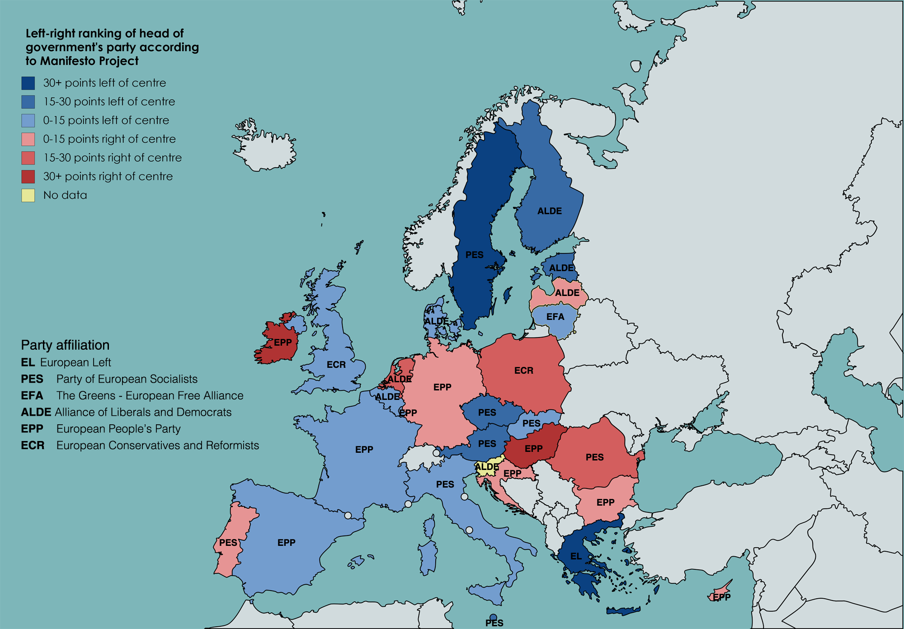
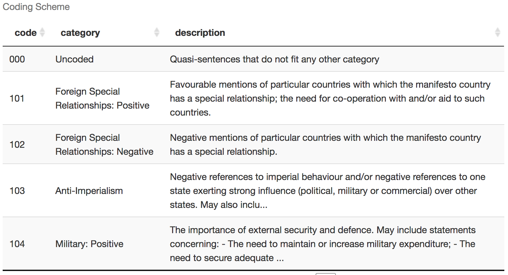

```{r setup, include = FALSE}
library(tidyverse) # Add the tidyverse package to my current library.
library(haven) # Handle labelled data.
library(essurvey) # Add ESS API package.
library(ggplot2) # Allows us to create nice figures.
library(Hmisc) # Weighted statistics.
library(manifestoR) # Add Manifesto API package.

options(width = 115, digits = 3)
```

## Reshaping

{width="45%"}

::: {.centered}
::: {.note}
*Source*: Garrick Aden-Buie's (\@grrrck) [Tidy Animated Verbs](https://github.com/gadenbuie/tidyexplain) modified by Mara Averick (\@dataandme).
:::
:::

---

## {background-image="https://www.eubulletin.com/wp-content/uploads/2017/12/European-WomenRights-620x280.jpg"}

**Are countries in which more persons of immigrant origin report to face religious discrimination, also characterized by more women of native-born parents reporting gender discrimination?**

## Let's get ready

```{r, include = FALSE, eval = FALSE}
# Import the ESS round 9 data via the API
ESS <- import_rounds(rounds = 9, ess_email = "merlin.schaeffer@uni-koeln.de", format = "spss")
```

```{r}
# Add packages to library
library(tidyverse) # Add the tidyverse package to my current library.
library(haven) # Handle labelled data.
library(essurvey) # Add ESS API package.
library(ggplot2) # Allows us to create nice figures.
library(Hmisc) # Weighted statistics.
library(manifestoR) # Add Manifesto API package.
```

## Let's get ready

```{r eval = FALSE}
ESS <- ESS %>% # Import the ESS, then (pipe result into)
  transmute( # Create new variables and keep only those
    cntry = as_factor(cntry), # Country of interview
    gndr = as_factor(gndr),
    facntr = as_factor(facntr), # Father born in cntry
    mocntr = as_factor(mocntr), # Mother born in cntry
    dscrgrp = as_factor(dscrgrp), # Belonging to discriminated group
    dscrrlg = as_factor(dscrrlg), # Discriminated because of religion
    comp_gr = case_when(
      facntr == "No" & mocntr == "No" ~ "ImiOr",
      gndr == "Female" ~ "Woman",
      TRUE ~ "Drop me") %>% as_factor(),
    dscrgnd = as_factor(dscrgnd), # Discriminated because of gender
    discr = case_when(
      dscrgrp == "Yes" & comp_gr == "Woman" & dscrgnd == "Marked"  ~ "Yes",
      dscrgrp == "Yes" & comp_gr == "ImiOr" & dscrrlg == "Marked" ~ "Yes",
      dscrgrp == "No" | (dscrgrp == "Yes" & dscrrlg != "Marked" & dscrgnd != "Marked") ~ "No",
      TRUE ~ as.character(NA)) %>% as_factor(), # all others missing, then change to factor
    pspwght = zap_labels(pspwght),
    eduyrs = case_when( # Education
      eduyrs > 21 ~ 21, # Recode to max 21 years of edu.
      eduyrs < 9 ~ 9, # Recode to min 9 years of edu.
      TRUE ~ zap_labels(eduyrs)), # Make it numeric
    atchctr = zap_labels(atchctr)) %>% # Emotionally attached to cntry, then
  dplyr::filter(
    # Keep only respondents of immigrant origin and women,
    comp_gr !=  "Drop me")
```

## Grouped operation {.smaller}
Along two dimensions

```{r eval = FALSE}
ESS_cntry <- ESS %>%
  mutate( # Make numeric discr. variable
    discr_num = case_when(
      discr == "Yes" ~ 1, 
      discr == "No" ~ 0,
      TRUE ~ NA_real_)) %>%
  group_by(cntry, comp_gr) %>%
  dplyr::summarize(
    n = sum(pspwght, na.rm = TRUE), # weighted number of cases,
    n_ed = sum(discr_num * pspwght, na.rm = TRUE), # weighted number who experienced discrimination,
    df = (n^2 / sum(pspwght^2, na.rm = TRUE)), # degrees of freedom,
    perc_discr = (n_ed / n) * 100, # weighted % who experienced discrimination,
    se_discr = sqrt(perc_discr * (100 - perc_discr) / n), # Standard error of the percent,
    min95_discr = perc_discr - se_discr * qt(p = 0.975, df = df), # Lower bound of 95% CI,
    max95_discr = perc_discr + se_discr * qt(p = 0.975, df = df) # Upper bound of 95% CI,
  )
```

## Grouped operation {.smaller}
Along two dimensions

```{r eval = FALSE}
ESS_cntry
```

. . .

But we cannot answer: "Are countries in which more persons of immigrant origin report to face religious discrimination, also characterized by more women of native-born parents reporting gender discrimination?"

Our data have country-groups as observational unit; **the values we want to correlate are in different rows!**

## Pivot wider {.smaller}
(i.e., reshape to wide)

::: columns
::: {.column width="50%"}
pivot wider is used, when what you want to have as observational unit, here the country, is found in several rows.

```{r eval = FALSE}
ESS_cntry %>%
  select(cntry, comp_gr, perc_discr) %>%
  dplyr::filter(cntry == "Denmark" | cntry == "Sweden" | cntry == "Germany" | cntry == "Norway") %>%
  knitr::kable(format = "markdown", digits = 2)
```
:::

::: {.column width="50%"}
We want to widen the data, so that there is only one row per country and several discrimination variables - one for each comparison group.

```{r eval = FALSE}
ESS_cntry %>%
  select(cntry, comp_gr, perc_discr) %>%
  dplyr::filter(cntry == "Denmark" | cntry == "Sweden" | cntry == "Germany" | cntry == "Norway") %>%
  pivot_wider(names_from = comp_gr, values_from = perc_discr) %>%
  knitr::kable(format = "markdown", digits = 2)
```
:::
:::

## `pivot_wider(names_from, values_from)`

::: columns
::: {.column width="50%"}
We want to widen the data, so that there is only one row per country and several discrimination variables - one for each comparison group.

```{r eval = FALSE}
ESS_cntry %>%
  select(cntry, comp_gr, perc_discr)
```
:::

::: {.column width="50%"}
- `names_from`: The column to take variable names from.
- `values_from`: The column to take values from.

```{r eval = FALSE}
(ESS_cntry <- ESS_cntry %>%
  select(cntry, comp_gr, perc_discr) %>%
  pivot_wider(names_from = comp_gr,
              values_from = perc_discr))
```
:::
:::

---

{width="50%"}

::: {.centered}
::: {.note}
*Source*: Garrick Aden-Buie's (\@grrrck) [Tidy Animated Verbs](https://github.com/gadenbuie/tidyexplain) modified by Mara Averick (\@dataandme).
:::
:::

---

::: {.centered}
**Are countries in which more persons of immigrant origin report to face religious discrimination, also characterized by more women of native-born parents reporting gender discrimination?**
:::

::: columns
::: {.column width="50%"}
```{r scatter1, fig.show = 'hide', eval = FALSE}
ggplot(data = ESS_cntry, 
       aes(y = Woman, x = ImiOr)) +
  geom_smooth(method = "lm", 
              se = FALSE, color = "red") +
  geom_smooth() +
  # Use the values of "cntry" instead as points.
  geom_text(aes(label = cntry)) +
  labs(y = "% Women reporting gender discrimination", 
       x = "% Persons of immigrant origin reporting religious discrimination") +
  theme_minimal()
```
:::

::: {.column width="50%"}
```{r ref.label = 'scatter1', echo = FALSE, fig.height= 5, fig.width = 6, out.width = '100%', eval = FALSE}
```
:::
:::

## `pivot_longer(names_to, values_to)`

::: columns
::: {.column width="50%"}
```{r eval = FALSE}
ESS_cntry
```
:::

::: {.column width="50%"}
```{r eval = FALSE}
ESS_cntry %>%
  pivot_longer(cols = c(ImiOr, Woman),
    names_to = "comp_gr", values_to = "perc_discr")
```

**Note that `cntry` is simply repeated!**
:::
:::

## Complex reshapes

Our original country data had more than one variable which we might want to pivot.

::: columns
::: {.column width="50%"}
```{r eval = FALSE}
ESS_cntry <- ESS %>%
  mutate( # Make numeric discr. variable
    discr_num = case_when(
      discr == "Yes" ~ 1, 
      discr == "No" ~ 0,
      TRUE ~ NA_real_)) %>%
  group_by(cntry, comp_gr) %>%
  dplyr::summarize(
    n = sum(pspwght, na.rm = TRUE), # weighted number of cases,
    n_ed = sum(discr_num * pspwght, na.rm = TRUE), # weighted number who experienced discrimination,
    df = (n^2 / sum(pspwght^2, na.rm = TRUE)), # degrees of freedom,
    perc_discr = (n_ed / n) * 100, # weighted % who experienced discrimination,
    se_discr = sqrt(perc_discr * (100 - perc_discr) / n), # Standard error of the percent,
    min95_discr = perc_discr - se_discr * qt(p = 0.975, df = df), # Lower bound of 95% CI,
    max95_discr = perc_discr + se_discr * qt(p = 0.975, df = df) # Upper bound of 95% CI,
  )
```
:::

::: {.column width="50%"}
```{r eval = FALSE}
ESS_cntry
```
:::
:::

## Complex reshapes {.smaller}
step one

```{r eval = FALSE}
(ESS_cntry <- ESS_cntry %>% # Use our long country data
   # select the vars we want to keep
   select(cntry, comp_gr, perc_discr, min95_discr, max95_discr) %>% # then
   pivot_wider(names_from = comp_gr, # Identify the from variables
               values_from =c(perc_discr, min95_discr, max95_discr)))
```

---

## {background-image="https://d33wubrfki0l68.cloudfront.net/245292d1ea724f6c3fd8a92063dcd7bfb9758d02/5751b/diagrams/relational-nycflights.png"}

**Relational data**

## **Relational data**

If you work with multiple data frames, you work with relational data — if the different data frames are somehow related, that is, **if they have some variable(s) in common**.

{width="60%"}

## Public opinion and party manifesto data

::: columns
::: {.column width="50%"}
{width="87%"}

```{r eval = FALSE}
(ESS_cntry <- ESS_cntry %>% # Focus on immigrant minorities
  select(cntry, perc_discr_ImiOr, 
         min95_discr_ImiOr, max95_discr_ImiOr))
```
:::

::: {.column width="50%"}
{width="90%"}

{width="90%"}
:::
:::

## What are the Manifesto data?

::: columns
::: {.column width="30%"}
{width="100%"}
:::

::: {.column width="70%"}
> A quasi-sentence is a single statement. A grammatical sentence can contain more than one quasi sentence, but a quasi-sentence can never span over more than one grammatical sentence.

::: {.note}
::: {.centered}
*Source*: [A short primer on the Manifesto Project and its methodology](https://manifesto-project.wzb.eu/tutorials/primer)
:::
:::

> […] President Obama has already signed into law $2 trillion in spending reductions as part of a balanced plan to reduce our deficits by over $4 trillion over the next decade // while taking immediate steps to strengthen the economy now. // This approach includes tough spending cuts that will bring annual domestic spending to its lowest level as a share of the economy in 50 years, // while still allowing us to make investments that benefit the middle class now // and reduce our deficit over a decade. […]

::: {.note}
::: {.centered}
*Source*: Democratic Party (US), Extract from 2012 Electoral Platform
:::
:::
:::
:::

Data source: [@volkensManifestoDataCollection2018]

## Register

::: columns
::: {.column width="50%"}
[Sign up](https://manifesto-project.wzb.eu/signup) for access to the Manifesto Project database and API (`manifestoR`).
:::

::: {.column width="50%"}
After registration, log in and access your profile:

{width="100%"}

Then generate an API key, download the txt file containing it, and save it into your R folder for this course.
:::
:::

## Register (continued)

```{r eval = FALSE}
mp_setapikey("manifesto_apikey.txt")
(Manif <- mp_maindataset())
```

## Multiculturalism over time

```{r, out.width='75%', fig.height=4, fig.width=8.5, eval = FALSE}
Manif %>% # Use the Manifesto data, then
  dplyr::filter(countryname == "Denmark" & # Filter manifestos from Denmark's prominent parties
                  (partyabbrev == "DF" | partyabbrev == "V" | partyabbrev == "SD" 
                   | partyabbrev == "EL" | partyabbrev == "KF" | partyabbrev == "RV")) %>% #, then
  ggplot(aes(y = per607, x = edate, color = partyname)) + # plot the result.
  geom_line() +
  labs(y = "% of positive \n quasi sentences about Multiculturalism", x = "Year") +
  theme_minimal()
```

## Multiculturalism over time (negative)

```{r, out.width='75%', fig.height=4, fig.width=8.5, eval = FALSE}
Manif %>% # Use the Manifesto data, then
  dplyr::filter(countryname == "Denmark" & # Filter manifestos from Denmark's prominent parties
                  (partyabbrev == "DF" | partyabbrev == "V" | partyabbrev == "SD" 
                   | partyabbrev == "EL" | partyabbrev == "KF" | partyabbrev == "RV")) %>% #, then
  ggplot(aes(y = per608, x = edate, color = partyname)) + # plot the result.
  geom_line() +
  labs(y = "% of negative \n quasi sentences about Multiculturalism", x = "Year") +
  theme_minimal()
```

## Multiculturalism over time (net)

```{r, out.width='75%', fig.height=4, fig.width=8.5, eval = FALSE}
Manif %>% # Use the Manifesto data, then
  dplyr::filter(countryname == "Denmark" & # Filter manifestos from Denmark's prominent parties
                  (partyabbrev == "DF" | partyabbrev == "V" | partyabbrev == "SD" 
                   | partyabbrev == "EL" | partyabbrev == "KF" | partyabbrev == "RV")) %>% #, then
  ggplot(aes(y = (per607 - per608), x = edate, color = partyname)) + # plot the result.
  geom_line() +
  labs(y = "% of positive - negative \n quasi sentences about Multiculturalism", x = "Year") +
  theme_minimal()
```

## {.center}

**Does the current average (vote-share weighted) multicultural orientation of parties in a country predict persons of immigrant origin's reports about religious discrimination?**

## Data preparation

```{r eval = FALSE}
(Manif_cntry <- Manif %>% # Use the Manifesto data, then
  select(countryname, edate, per607, per608, pervote) %>% # Select the vars we need, then
  group_by(countryname) %>% # Group the data by country, then
  dplyr::filter(edate == max(edate)) %>% # Use only the most recent manifestos from each country, then
  dplyr::summarize( # Calculate the average, vote-share weighted, multicultural orientation of all parites.
    party_multicult = weighted.mean((per607 - per608), w = (pervote / 100), na.rm = TRUE)
  ))
```

## Average multicultural orientation by country

```{r, out.width='90%', fig.height=4, fig.width=8.5, eval = FALSE}
ggplot(data = Manif_cntry, mapping = aes(y = party_multicult, x = reorder(countryname, party_multicult))) +
  geom_bar(stat = "identity") +
  theme_minimal() +
  labs(y = "Average vote-share weighted \n multicultural orientation", x = "Country") +
  theme(axis.text.x = element_text(angle = 90, hjust = 1))
```

## **Relational data**

Our two data frames are related, because we have data from several *countries*. Country is the key that allows us to relate both data frames. A **key** identifies a single observational unit in a data frame. From the perspective of the ESS, `cntry` is the **primary key**, and `countryname` is the **foreign key**. **If we can *harmonize the primary and foreign key*, we can join/merge the data.**

::: columns
::: {.column width="50%"}
```{r eval = FALSE}
ESS_cntry
```
:::

::: {.column width="50%"}
```{r eval = FALSE}
(Manif_cntry <- Manif_cntry %>% 
   mutate(cntry = countryname) %>%
   select(-countryname))
```
:::
:::

## **Join**/merge {.smaller}
four different types

::: columns
::: {.column width="50%"}
{width="90%"}

::: {.note}
::: {.centered}
*Source*: [Tidy Animated Verbs](https://github.com/gadenbuie/tidyexplain)
:::
:::
:::

::: {.column width="50%"}
{width="90%"}

::: {.note}
::: {.centered}
*Source*: [Tidy Animated Verbs](https://github.com/gadenbuie/tidyexplain)
:::
:::
:::
:::

## **Join**/merge {.smaller}
four different types

::: columns
::: {.column width="50%"}
{width="90%"}

::: {.note}
::: {.centered}
*Source*: [Tidy Animated Verbs](https://github.com/gadenbuie/tidyexplain)
:::
:::
:::

::: {.column width="50%"}
{width="90%"}

::: {.note}
::: {.centered}
*Source*: [Tidy Animated Verbs](https://github.com/gadenbuie/tidyexplain)
:::
:::
:::
:::

## Inner join/merge

Now that we have a shared key, we can join one data frame to the other. Our primary data are ESS_cntry, because it contains our outcome: Perceived discrimination. We want to join multiculturalist orientations of parties, but only for the countries for which we have an outcome.

```{r eval = FALSE}
(ESS_cntry <- inner_join(x = ESS_cntry, y = Manif_cntry, by = "cntry"))
```

## Does multiculturalism predict discrimination?

::: {.centered}
**Does the current average (vote-share weighted) multicultural orientation of parties in a country predict persons of immigrant origin's reports about religious discrimination?**
:::

::: columns
::: {.column width="50%"}
```{r scatter2, fig.show = 'hide', eval = FALSE}
ggplot(data = ESS_cntry, 
       aes(y = perc_discr_ImiOr, 
           x = party_multicult)) +
  geom_smooth() +
  geom_smooth(method = "lm", 
              se = FALSE, color = "red") +
  geom_text(mapping = aes(label = cntry)) +
  labs(y = "% Persons of immigrant origin \n reporting religious discrimination", 
       x = "Vote-share weighted multicultural orientation of parties") +
  theme_minimal()
```
:::

::: {.column width="50%"}
```{r ref.label="scatter2", echo = FALSE, out.width='100%', fig.height= 5, fig.width = 6, eval = FALSE}
```
:::
:::

## **One-to-many joins**

::: columns
::: {.column width="50%"}
So far, our primary and foreign keys identified only one observation in each data frame. But you can also join one to many or many to one. An example is to join the average multiculturalist orientation of parties in one country to each ESS respondent in that country.
:::

::: {.column width="50%"}
{width="90%"}

::: {.note}
::: {.centered}
*Source*: [Tidy Animated Verbs](https://github.com/gadenbuie/tidyexplain)
:::
:::
:::
:::

## **Many-to-many joins** {.smaller}
Be careful!

::: columns
::: {.column width="50%"}
If neither the primary nor the foreign key are unique in their data frames, **join probably does something that you do not want!** It will return all possible combinations, and thereby inflate the number of observations.
:::

::: {.column width="50%"}
{width="100%"}
:::
:::

## Today's general lessons

1. If we group data by several groups (e.g., countries and gender, or ethnicity and religion), we sometimes need to tidy/reshape data for our analyses. We might need to *spread* data (reshape from long to wide) into several columns.
2. Oftentimes we work with several data frames/tibbles. If they have some variables in common (e.g., time, place, type) they are *relational data*, because via that shared characteristic they are related. Relational data can me joined/merged via key variables. One-to-one joins are the easiest, but even one-to-many and many-to-many joins are possible. This means, for instance, you can join about every existing country information to your ESS data, or any party information to your Manifesto data.

## Today's (important) functions

1. `spread()`: Reshapes the data if what you want as observational unit is found in several rows. It takes the values of a *key* variable and turns those into new columns across which cells the values of a *value* variable are spread.
2. `gather()`: The opposite of spread.
3. `unite()`: Unite two columns/variables into one.
4. ...`_join()`: joins a tibble to another tibble. There are different types of join functions. Probably the most useful one is `left_join()`, which joins a tibble to your primary tibble and keeps only rows that were in your primary tibble to begin with.

## Literatur

::: {#refs}
:::
