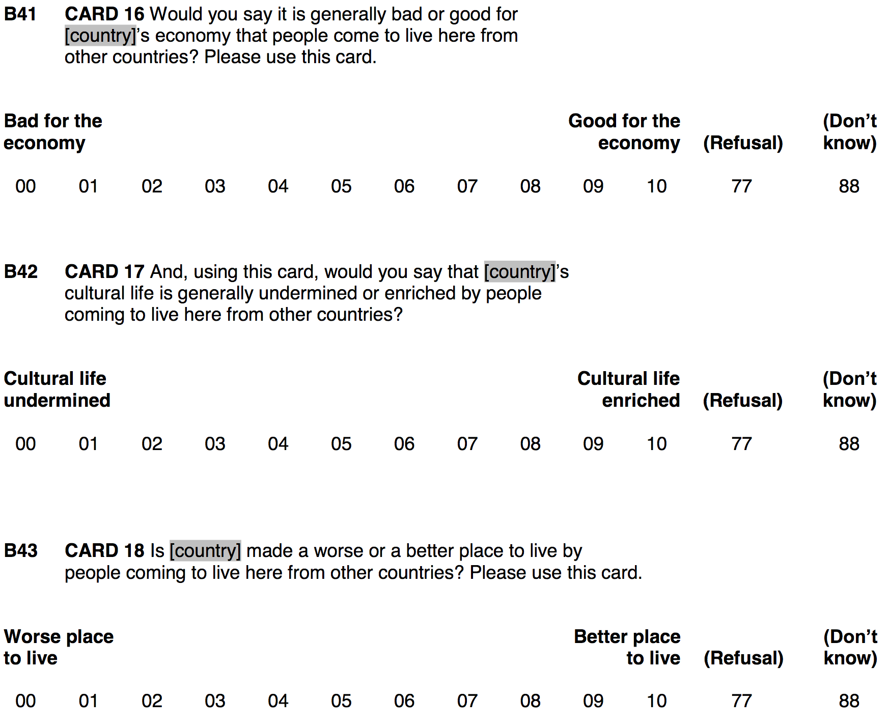
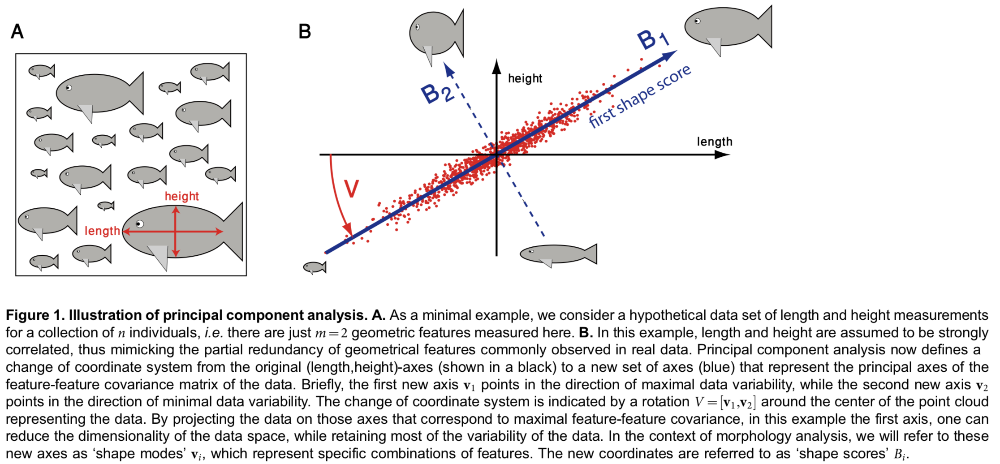
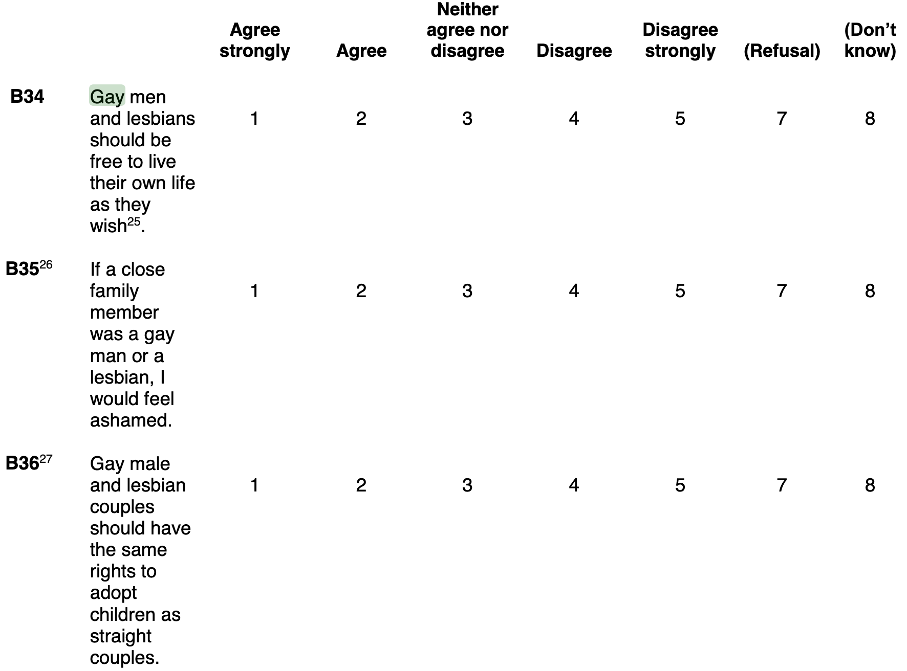

## {background-image="https://www.amnesty.org/remote.axd/aineupstrmediaprd.blob.core.windows.net/media/11413/222996_gay_rights_-_gay_parade_christopher_street_day.jpg?center=0.5%2c0.5&preset=fixed_1472_42_hi"}

```{r setup, include = FALSE}
library(tidyverse)
library(haven)
library(essurvey)
library(ggplot2)
library(factoextra)
library(psych)
library(rayshader)
```

---

## Let's get ready

```{r}
# Add packages to library
library(tidyverse) # Add the tidyverse package to my current library.
library(haven) # Handle labelled data.
library(essurvey) # Add ESS API package.
library(ggplot2) # Allows us to create nice figures.
library(factoextra) # Allows us to visualize PCAs
library(psych) # Supports PCA & factor analysis with several useful functions.
library(rayshader) # 3d ggplots
```

```{r include = FALSE, eval = FALSE}
# Import the ESS round 9 data via the API
ESS <- import_rounds(rounds = 9, ess_email = "merlin.schaeffer@uni-koeln.de", format = "spss")
```

---

## Prepare the data

```{r eval = FALSE}
ESS <- ESS %>% # Import the ESS, then (pipe result into)
  transmute( # Create new variables and keep only those
    cntry = as_factor(cntry), # Country of interview
    gndr = as_factor(gndr), # Gender
    facntr = as_factor(facntr), # Father born in cntry
    mocntr = as_factor(mocntr), # Mother born in cntry
    # Homophobia
    freehms = zap_labels(freehms),
    hmsfmlsh = max(hmsfmlsh, na.rm = TRUE) - zap_labels(hmsfmlsh),
    hmsacld = zap_labels(hmsacld),
    # Xenophobia
    imbgeco = max(imbgeco, na.rm = TRUE) - zap_labels(imbgeco),
    imueclt = max(imueclt, na.rm = TRUE) - zap_labels(imueclt),
    imwbcnt = max(imwbcnt, na.rm = TRUE) - zap_labels(imwbcnt),
    pspwght = zap_labels(pspwght),
    eduyrs = case_when( # Education
      eduyrs > 21 ~ 21, # Recode to max 21 years of edu.
      eduyrs < 9 ~ 9, # Recode to min 9 years of edu.
      TRUE ~ zap_labels(eduyrs))) %>% # Make it numeric, then
  dplyr::filter(
    # Keep only respondents with native-born parents,
    facntr == "Yes" & mocntr == "Yes",
    # filter cases from four countries
    cntry == "Denmark" | cntry == "Germany" | cntry == "Sweden" | cntry == "Norway")
```

## {background-image="https://drupal-images.tv2.dk/sites/images.tv2.dk/files/t2img/2019/12/18/960x540/311984641-7613085-3c76aadd7dd99694e5f5bb3c787190d6.jpeg"}

```{r, out.width='60%', fig.align='center', fig.retina = 3}

```

---

## Scales {.smaller}

### Do items measure an underlying "latent" concept?

::: columns
::: {.column width="50%"}
First, check whether the $k$ items correlate.
::: {.note}
Maybe also use scatterplots to check whether they are *linearly* associated.
:::

```{r eval = FALSE}
ESS %>% select(imbgeco, imueclt, imwbcnt) %>% 
  # Estimate correlations among all vars
  cor(use = "complete.obs")  # piped into cor()
```

Second, we try to come up with a *measurement model* of the form:

$$y_i = \beta_{1}x_{1i} + \beta_{2}x_{2i} + ... + \beta_{k}x_{ki}$$

::: {.centered}
$\Rightarrow$ But how to choose the $\beta$?
:::
:::

::: {.column width="50%"}
**Additive scales** The old-school way

```{r eval = FALSE}
ESS <- ESS %>% # Use the ESS, then
  mutate( # Create new variable
    # Sum the three items and devide by k.
    # Same as summing items, each multiplied by 1/k.
    xeno = (imbgeco + imueclt + imwbcnt) / 3,
  )
```

Additive scales assume that all items are similarly-important indicators, that is, every $\beta$ is set to $\frac{1}{k}$.
:::
:::

---

## Additive scales {.smaller}

### The old-school way to build a scale

::: columns
::: {.column width="50%"}
```{r histo1, fig.show = "hide", eval = FALSE}
# Make a histogram of the additive xenophobia scale
ggplot(data = ESS) +
  geom_histogram(aes(x = xeno), 
                color = "#901A1E", 
                fill = "#901A1E") +
  labs(title = "Xenophobia", 
       subtitle = "Additive scale of three items", 
       x = "") +
  theme_minimal()
```
:::

::: {.column width="50%"}
```{r ref.label = "histo1", out.width='100%', fig.height = 4, fig.width = 5, eval = FALSE}
```
:::
:::

---

## Additive scales {.smaller}

### The old-school way to build a scale

::: columns
::: {.column width="50%"}
```{r density1, fig.show = "hide", warning = FALSE, message = FALSE, eval = FALSE}
# Make a density plot of the additive xenophobia scale
ggplot(data = ESS) +
  geom_density(aes(x = xeno), 
                color = "#901A1E", 
               fill = "#901A1E", alpha = 1/2) +
  labs(title = "Xenophobia", 
       subtitle = "Additive scale of three items", 
       x = "") +
  theme_minimal()
```
:::

::: {.column width="50%"}
```{r ref.label = "density1", out.width='100%', fig.height = 4, fig.width = 5, eval = FALSE}
```
:::
:::

---

## Additive scales — relation to education

::: columns
::: {.column width="50%"}
```{r out.width='90%', fig.height = 3.5, fig.width = 6, eval = FALSE}
ggplot(data=ESS, aes(y=xeno, x=eduyrs)) +
  geom_jitter(alpha = 1/5) +
  geom_smooth() +
  labs(y = "Xenophobia (additive scale)", 
       x = "Years of education")
```

```{r eval = FALSE}
ESS %>% select(xeno, eduyrs) %>% 
  drop_na() %>% cor()
```
:::

::: {.column width="50%"}
```{r out.width='90%', fig.height = 3.5, fig.width = 6, eval = FALSE}
ggplot(data=ESS, aes(y=imwbcnt, x=eduyrs)) +
  geom_jitter(alpha = 1/5) +
  geom_smooth() +
  labs(y = "Immigration good/bad for country", 
       x = "Years of education")
```

```{r eval = FALSE}
ESS %>% select(imwbcnt, eduyrs) %>% 
  drop_na() %>% cor()
```
:::
:::

---

## Additive scales {.smaller}

### A first problem

::: columns
::: {.column width="50%"}
Take this two-variable case as example. As additive scale: $\text{Xeno} = \frac{1}{2}*\text{imbgeco} + \frac{1}{2}*\text{imwbcnt}.$
:::

::: {.column width="50%"}
```{r echo = FALSE, out.width='70%', fig.height = 5, fig.width = 5, eval = FALSE}
set.seed(831983)
ggplot(data = ESS, mapping = aes(y = imbgeco, x = imueclt)) +
  geom_jitter(alpha = 0) +
  geom_abline(aes(intercept = 0, slope = 1, color = "black"), size = 1) +
  coord_fixed() +
  scale_color_identity(labels = c("Additive scale"), guide = "legend") +
  theme_minimal() +
  theme(legend.position = c(0.87, 0.1), legend.background = element_rect(fill = NA, color = NA))
```
:::
:::

---

## Additive scales {.smaller}

### A first problem

::: columns
::: {.column width="50%"}
Take this two-variable case as example. As additive scale: $\text{Xeno} = \frac{1}{2}*\text{imbgeco} + \frac{1}{2}*\text{imwbcnt}.$
:::

::: {.column width="50%"}
```{r echo = FALSE, out.width='70%', fig.height = 5, fig.width = 5, eval = FALSE}
set.seed(831983)
ggplot(data = ESS, mapping = aes(y = imbgeco, x = imueclt)) +
  geom_jitter(alpha = 1/10) +
  geom_abline(aes(intercept = 0, slope = 1, color = "black"), size = 1) +
  coord_fixed() +
  scale_color_identity(labels = c("Additive scale"), guide = "legend") +
  theme_minimal() +
  theme(legend.position = c(0.87, 0.1), legend.background = element_rect(fill = NA, color = NA))
```
:::
:::

## {background-image="https://www.neuraldesigner.com/images/pca-blog.jpeg"}

::: {.centered}
**Principal Components Analysis**

*Source*: [Pablo Martin](https://www.neuraldesigner.com/blog/principal-components-analysis)
:::

---

## Principal Components Analysis {.smaller}

### The goal

```{r, out.width='95%', fig.align='center'}

```

::: {.note}
*Source*: @wernerShapeModeAnalysis2014
:::

---

## PCA {.smaller}

### Intuition of the mechanics

::: columns
::: {.column width="50%"}
According to PCA, it would be better to give `imueclt` a larger $\beta$ than `imbgeco`.

The reason is that the respondents' answers to `imueclt` are more varied. That is, one could argue that they *contain more information*!

```{r eval = FALSE}
sd(ESS$imbgeco, na.rm = TRUE)
sd(ESS$imueclt, na.rm = TRUE)
```

Vice versa, variables that have mostly the same values across cases are not very informative. The key point here is: Cases are different — but variables with little variation make them look similar. PCA thus looks to emphasize variables with a lot of variation, to clarify how cases differ.
:::

::: {.column width="50%"}
```{r echo = FALSE, out.width='95%', fig.height = 5, fig.width = 5, eval = FALSE}
pca <- prcomp(~ imbgeco + imueclt, data = ESS, na.action = na.exclude)
slp <- with(pca, rotation[1,1] / rotation[2,1])
int <- with(pca, center[1] - slp*center[2])

set.seed(831983)
ggplot(data = ESS, mapping = aes(y = imbgeco, x = imueclt)) +
  geom_jitter(alpha = 1/10) +
  geom_abline(aes(intercept = 0, slope = 1, color = "black"), size = 1, alpha = 2/3) +
  geom_abline(aes(intercept = int, slope = slp, color = "red"), size = 1) +
  coord_fixed() +
  scale_color_identity(labels = c("Additive", "PCA"), guide = "legend") +
  theme_minimal() +
  theme(legend.position = c(0.87, 0.1), legend.background = element_rect(fill = NA, color = NA))
```
:::
:::

---

## PCA {.smaller}

### Intuition of the mechanics

::: columns
::: {.column width="50%"}
Our measurement model $y_i = \beta_{1}x_{1i} + \beta_{2}x_{2i} + ... + \beta_{k}x_{ki}$ *projects* the original data onto a new variable (i.e., in PCA lingo, a new coordinate-system axis, aka a principal component). But depending on how we choose the $\beta$, many projections are possible; which one is the best?

**PCA's answer**: Choose the $\beta$ such that
$\text{Var}(y_i) \rightarrow \max$. That is, the new variable should vary as much as possible (i.e., should contain as much information as possible).
:::

::: {.column width="50%"}
{width="100%"}

> If you stare at this animation for some time, you will notice that "the maximum variance" and "the minimum error" are reached at the same time, namely when the line points to the magenta ticks [...].

::: {.note}
*Source*: ["amoeba" on Stackexchange](https://stats.stackexchange.com/questions/2691/making-sense-of-principal-component-analysis-eigenvectors-eigenvalues/2700)
:::
:::
:::

---

## PCA {.smaller}

### Intuition of the mechanics

::: columns
::: {.column width="50%"}
Our measurement model $y_i = \beta_{1}x_{1i} + \beta_{2}x_{2i} + ... + \beta_{k}x_{ki}$ *projects* the original data onto a new variable (i.e., in PCA lingo, a new coordinate-system axis, aka a principal component). But depending on how we choose the $\beta$, many projections are possible; which one is the best?

**PCA's answer**: Choose the $\beta$ such that
$\text{Var}(y_i) \rightarrow \max$. That is, the new variable should vary as much as possible (i.e., should contain as much information as possible).
:::

::: {.column width="50%"}
{width="100%"}

> By the way, you can imagine that the black line is a solid rod and each red line is a spring. The energy of the spring is proportional to its squared length (this is known in physics as the Hooke's law), so the rod will orient itself such as to minimize the sum of these squared distances.

::: {.note}
*Source*: ["amoeba" on Stackexchange](https://stats.stackexchange.com/questions/2691/making-sense-of-principal-component-analysis-eigenvectors-eigenvalues/2700)
:::
:::
:::

---

## Principal Components Analysis in R

::: columns
::: {.column width="50%"}
```{r eval = FALSE}
# Perform pca of three items and write the results
# into object xeno_pca.
(xeno_pca <- ESS %>% prcomp(
     formula = ~ imbgeco + imueclt + imwbcnt,
     data = ., na.action = na.exclude))

# Show importance of single components.
summary(xeno_pca) 
```
:::

::: {.column width="50%"}
1. A PCA produces *components*. You can think of them as the new variable(s), that is $y_{i}$ of our measurement model. 

2. PCA will produce $k$ components, ordered by the amount of information/variation they capture. `summary()` tells you the importance of the single components. In our case, PC1 has a $\text{SD}(\text{PC1}) =  3.465$, which is higher than that of any of the single items (e.g., $\text{SD}(\text{imueclt}) = 2.4$ ). A component that captures less info than the most informative single variable of the original data is pretty useless.

3. The *Rotation* tells you the $\beta$ for each component. $y_i = 0.54x_{1i} + 0.63x_{2i} + 0.55x_{3i}$. Hence, you need to interpret the meaning of any component based on the $\beta$!
:::
:::

---

## Visualize the first two PCs {.smaller}

### to ease interpretation

::: columns
::: {.column width="50%"}
```{r plot-pca, fig.show = "hide", eval = FALSE}
# Visualize PCA object
fviz_pca_var(xeno_pca)
```

*Interpretation*: As our first principal component increases by one, scores on `imbgeco` increase by roughly 1.8.
:::

::: {.column width="50%"}
```{r ref.label = "plot-pca", out.width='100%', fig.height = 4, fig.width = 5, eval = FALSE}
```
:::
:::

---

## Adding a PC to your data

::: columns
::: {.column width="50%"}
Our `xeno_pca` object also contains the projections onto the principal components for each respondent (i.e., the latent xenophobia variable).
```{r eval = FALSE}
# Show tibble of respondents' scores
# on the three principal components.
as_tibble(xeno_pca$x) 
```
:::

::: {.column width="50%"}
You can add a principal component to your data (*but only if* you have specified<br> `na.action = na.exclude` in your `prcomp()`):
```{r eval = FALSE}
# Make a new "xeno_pc" variable 
# and fill it with PC1.
ESS$xeno_pc <- xeno_pca$x[ , "PC1"] 
```
:::
:::

---

## Additive vs. PCA scale compared

::: panel-tabset
## Plot
```{r echo = FALSE, out.width='40%', fig.height = 4, fig.width = 5, eval = FALSE}
# Make a density plot comparing the
# additive versus PC xenophobia scales
ggplot(data = ESS) +
  geom_density(aes(x = xeno - mean(xeno, na.rm = TRUE), 
                   color = "#901A1E", fill = "#901A1E"),
               alpha = 1/2) +
  geom_density(aes(x = xeno_pc, color = "#1f78b4", 
                   fill = "#1f78b4"), alpha = 1/2) +
  scale_color_identity("", 
                       labels = c("PCA", "Additive"), 
                       guide = "legend") +
  scale_fill_identity("", 
                      labels = c("PCA", "Additive"), 
                       guide = "legend") +
  labs(x = "Xenophobia", y = "Density") +
  theme_minimal() +
  theme(legend.position = c(0.15, 0.9), 
        legend.background = element_rect(fill = NA, color = NA))
```

## Code
```{r fig.show = "hide", eval = FALSE}
# Make a density plot comparing the
# additive versus PC xenophobia scales
ggplot(data = ESS) +
  geom_density(aes(x = xeno - mean(xeno, na.rm = TRUE), 
                   color = "#901A1E", fill = "#901A1E"), alpha = 1/2) +
  geom_density(aes(x = xeno_pc, color = "#1f78b4", fill = "#1f78b4"), alpha = 1/2) +
  scale_color_identity("", labels = c("PCA", "Additive"), guide = "legend") +
  scale_fill_identity("", labels = c("PCA", "Additive"), guide = "legend") +
  labs(x = "Xenophobia", y = "Density") +
  theme_minimal() +
  theme(legend.position = c(0.15, 0.9), legend.background = element_rect(fill = NA, color = NA))
```
:::

```{r include = FALSE}
options(digits = 5)
```

```{r eval = FALSE}
# Correlation between education and the xenophobia PC
# is slightly higher, indicating less measurement error
ESS %>% select(xeno_pc, xeno, eduyrs) %>% 
  drop_na() %>% cor()
```

```{r include = FALSE}
options(digits = 2)
```

---

## Z-standardized PCA

::: columns
::: {.column width="50%"}
```{r message = FALSE, warning = FALSE, eval = FALSE}
# Perform pca
(xeno_pca2 <- ESS %>% 
   prcomp(
     formula = ~ imbgeco + imueclt + imwbcnt,
     data = ., na.action = na.exclude,
     scale = TRUE))

# Show importance of single components (no space this time).
summary(xeno_pca2) 
```
:::

::: {.column width="50%"}
1. *If you PCA items with differing scales (e.g., income, age, homophobia), you should always z-standardize!* You do not want income to matter more if measured in DKK rather than Euro ...

2. For PCA, z-standardization means that *correlations between items become more important*. That is, emphasis is given not to items that vary more (all have $\text{SD} = 1$ now), but to items that correlate more with other items. This seems highly desirable!

3. Since all items now have $\text{SD} = 1$, importance of any meaningful components should be > 1.
:::
:::

---

## Visualize the first two PC {.smaller}

### to ease interpretation

::: columns
::: {.column width="50%"}
```{r plot-pca2, fig.show = "hide", warning = FALSE, message = FALSE, eval = FALSE}
# Visualize PCA object
fviz_pca_var(xeno_pca2) 
```
*Interpretation*: Now that we have z-standardized, interpretation is easier. As our first principal component increases by one sd, `imbgeco` decreases by roughly 0.8 sd (i.e., $r = 0.8$). 

PC1/Dim1 clearly measures Xenophobia. PC2/Dim2 seems to have no clear interpretation.
:::

::: {.column width="50%"}
```{r ref.label = "plot-pca2", out.width='100%', fig.height = 4, fig.width = 5, eval = FALSE}
```
:::
:::

## {background-image="https://www.amnesty.org/remote.axd/aineupstrmediaprd.blob.core.windows.net/media/11413/222996_gay_rights_-_gay_parade_christopher_street_day.jpg?center=0.5%2c0.5&preset=fixed_1472_42_hi"}

::: columns
::: {.column width="50%"}
```{r, out.width='100%', fig.align='center', fig.retina = 3}

```
:::

::: {.column width="50%"}
```{r, out.width='100%', fig.align='center', fig.retina = 3}

```
:::
:::

---

## PCA of xeno- and homophobia items

```{r eval = FALSE}
# PC-analyze z-standardized xeno- and homophobia items
(big_pca <- prcomp(~ freehms + hmsfmlsh + hmsacld + 
                    imbgeco + imueclt + imwbcnt, 
                  data = ESS, na.action = na.exclude, 
                  scale = TRUE))

# Give a summary of the retrieved PCs importance
summary(big_pca)
```

---

## PCA of xeno- and homophobia items — rotation needed

::: columns
::: {.column width="50%"}
Because PCA tries to maximize the variance of each component iteratively/successively, the first component contains info from xenophobia and homophobia items. Conflating both types of items, which seem to measure two theoretically-distinct concepts, maximizes the variance on the first component. Therefore the PCA cannot clearly separate the two phenomena. 

A **rotation** of the principal components that maximizes the distinctiveness with which the different items load on the principal components would solve that problem. Such a rotation could:
  
  - Conserve the orthogonality (i.e., uncorrelated) of the principal components: `varimax()`
  - Allow the principal components to be oblique (i.e., correlated): `promax()`
:::

::: {.column width="50%"}
```{r out.width='100%', fig.align='center', fig.height = 4, fig.width = 5, fig.retina = 3, eval = FALSE}
# Visualize PCA object
fviz_pca_var(big_pca)
```
:::
:::

---

## Orthogonal and oblique rotations

::: columns
::: {.column width="50%"}
```{r eval = FALSE}
# Orthogonal rotation
(orthogonal_solution <- varimax(
  # of first two PCs
  big_pca$rotation[, c("PC1", "PC2")]))
```
:::

::: {.column width="50%"}
```{r eval = FALSE}
# Oblique rotation
(oblique_solution <- promax(
  # of first two PCs
  big_pca$rotation[, c("PC1", "PC2")]))
```
:::
:::

---

## Principal components after rotation

::: columns
::: {.column width="50%"}
```{r plot-pca6, fig.show = "hide", eval = FALSE}
# Overwrite the original PCA loadings with
# the new rotated ones.
big_pca$rotation <- oblique_solution$loadings

# Visualize the updated PCA object
fviz_pca_var(big_pca) 
```
:::

::: {.column width="50%"}
```{r ref.label = "plot-pca6", out.width='100%', fig.height = 4, fig.width = 5, eval = FALSE}
```
:::
:::

---

## New component scores after rotation

::: columns
::: {.column width="50%"}
```{r eval = FALSE}
# Generate new component scores for every respondent 
# based on the rotated principal components and write
# the into object "rotated_PCs"
rotated_PCs <- ESS %>% 
  select(freehms, hmsfmlsh, hmsacld, imbgeco, 
         imueclt, imwbcnt) %>% 
  factor.scores(x = ., f = big_pca$rotation)

# Add a "xeno_pc3" and "homoph_pc" from "rotated_PCs" to our data.
# Given the items loadings, we do not need to turn them.
ESS[, c("xeno_pc3", "homoph_pc")] <- rotated_PCs$scores

# Turn homophobia scale
ESS$homoph_pc <-max(ESS$homoph_pc, na.rm = TRUE) - ESS$homoph_pc
```
:::

::: {.column width="50%"}
::: panel-tabset
## Plot
```{r echo = FALSE, out.width='100%', fig.height = 4, fig.width = 5, eval = FALSE}
# Make a two-dimensional density plot of
# Xenophobia and Homophobia
(density_plot <- ggplot(data = ESS,
                        aes(y = xeno_pc3, x = homoph_pc)) +
  # 50 Density-colored hexagons in each direction
  stat_density_2d(aes(fill = stat(density)), 
                  geom = "raster",
                  n = 200, bins = 10, contour = FALSE) +
     # geom_hex(bins = 20, size = 0.5, color = "black") +
  scale_fill_viridis_c(option = "A") +
  labs(y = "Xenophobia", x = "Homophobia",
       caption = "Data: European Social Survey. \n Scales based on standardized PCA \n followed by oblique rotation.") +
  theme_minimal())
```

## Code
```{r fig.show = "hide", eval = FALSE}
# Make a two-dimensional density plot of
# Xenophobia and Homophobia
(density_plot <- ggplot(data = ESS,
                        aes(y = xeno_pc3, x = homoph_pc)) +
  # 50 Density-colored hexagons in each direction
  stat_density_2d(aes(fill = stat(density)), 
                  geom = "raster",
                  n = 200, bins = 10, contour = FALSE) +
     # geom_hex(bins = 20, size = 0.5, color = "black") +
  scale_fill_viridis_c(option = "A") +
  labs(y = "Xenophobia", x = "Homophobia",
       caption = "Data: European Social Survey. \n Scales based on standardized PCA \n followed by oblique rotation.") +
  theme_minimal())
```
:::
:::
:::

---

## 3D Density plot

::: columns
::: {.column width="50%"}
```{r eval = FALSE}
# Make 3D plot 
plot_gg(density_plot, multicore = TRUE, 
        width = 5, height = 5, scale = 250)
```

```{r eval = FALSE}
ESS %>% select(xeno_pc3, homoph_pc) %>%
  drop_na() %>% cor()
```
:::

::: {.column width="50%"}
```{r echo = FALSE, include = FALSE, out.width='100%', eval = FALSE}
plot_gg(density_plot, width = 4, height = 4, scale = 300, 
        multicore = TRUE, windowsize = c(1000, 800),
        zoom = 0.55)
Sys.sleep(0.2) # Let R rest briefly
render_movie(filename = "my_movie.mp4")
```

<!-- Note: the rendered rayshader video (my_movie.mp4) is not migrated;
     this code is illustrative of the 3D rayshader workflow only. -->
:::
:::

---

## Today's (important) functions

1. `cor()`: Estimate correlations.
2. `prcomp()`: Estimate principal components analysis.
3. `na.exclude()`: Case-wise deletion (i.e., delete all rows with missing value on any variable).
4. `fviz_pca_var()`: Visualize your PCA to ease interpretation.

---

## Literatur

::: {#refs}
:::
