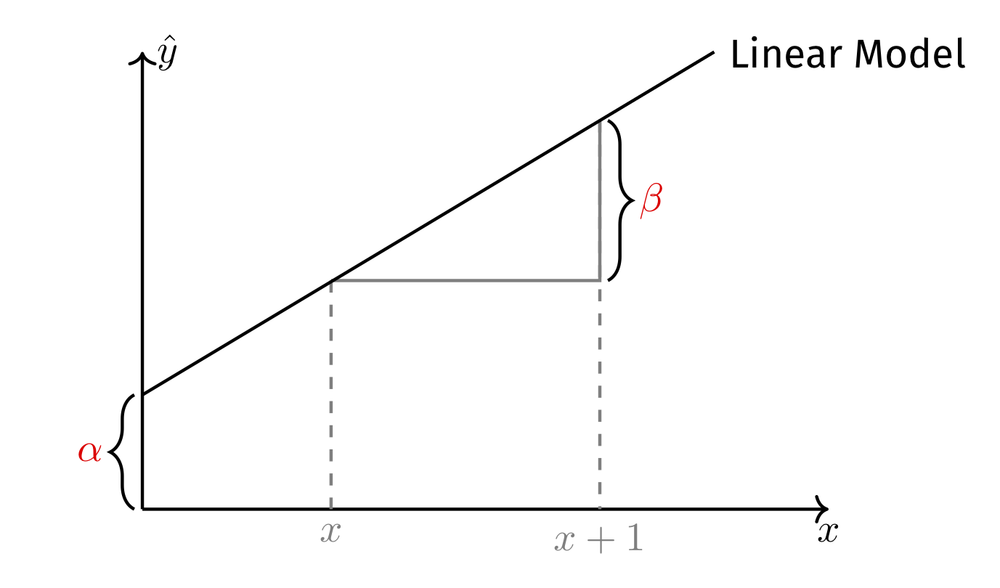

```{r setup, include = FALSE}
library(equatiomatic)
library(dagitty) # Use the dagitty package
library(ggdag) # Neat visualization of DAGs
```

## Let's get ready

```{r}
# Add packages to library
library(tidyverse) # Add the tidyverse package to my current library.
library(haven) # Handle labelled data.
library(essurvey) # Add ESS API package.
library(ggplot2) # Allows us to create nice figures.
library(factoextra) # Allows us to visualize PCAs.
library(psych) # Supports PCA & factor analysis with several useful functions.
library(estimatr) # Allows us to estimate (cluster-)robust standard errors.
library(texreg) # Allows us to make nicely-formatted Html & Latex regression tables.
library(broom) # Allows us to turn model objects into tibbles.
```

```{r include = FALSE, eval = FALSE}
# Import the ESS round 9 data via the API
ESS <- import_rounds(rounds = 9, ess_email = "merlin.schaeffer@uni-koeln.de", format = "spss")
```

---

```{r eval = FALSE}
ESS <- ESS %>% transmute( # Create new variables and keep only those
    cntry = as_factor(cntry), # Country of interview
    gndr = as_factor(gndr),
    facntr = as_factor(facntr), # Father born in cntry
    mocntr = as_factor(mocntr), # Mother born in cntry
    imbgeco = max(imbgeco, na.rm = TRUE) - zap_labels(imbgeco),
    imueclt = max(imueclt, na.rm = TRUE) - zap_labels(imueclt),
    imwbcnt = max(imwbcnt, na.rm = TRUE) - zap_labels(imwbcnt),
    pspwght = zap_label(pspwght),
    # Parental education (ISCED)
    eiscedf = zap_labels(eiscedf),
    eiscedm = zap_labels(eiscedm),
    par_edu = case_when(
      # If father's edu is missing but not mother's, take mother's
      (eiscedf == 55 | is.na(eiscedf)) & eiscedm != 55 & !is.na(eiscedm) ~ eiscedm,
      # If mother's edu is missing but not father's, take father's
      (eiscedm == 55 | is.na(eiscedm)) & eiscedf != 55 & !is.na(eiscedf)  ~ eiscedf,
      # If both are missing, its missing
      eiscedf == 55 & eiscedm == 55 ~ as.numeric(NA),
      # For all others, take the average of both parents
      TRUE ~ (eiscedm + eiscedf) / 2),
    eduyrs = case_when( # Education
      eduyrs > 21 ~ 21, # Recode to max 21 years of edu.
      eduyrs < 9 ~ 9, # Recode to min 9 years of edu.
      TRUE ~ zap_labels(eduyrs))) %>% # Make it numeric, then
  dplyr::filter(
    # Keep only respondents with native-born parents,
    facntr == "Yes" & mocntr == "Yes" &
      (cntry == "Denmark" | cntry == "Sweden" | cntry == "Norway" | cntry == "Germany"))
```

## PCA & design matrix

```{r eval = FALSE}
# Perform pca of three items and write the results into object xeno.
(xeno <- ESS %>% 
   prcomp(formula = ~ imbgeco + imueclt + imwbcnt, 
          data = ., scale = TRUE, center = TRUE,
          na.action = na.exclude))

# Make a new "xeno" variable and fill it with z-standardized PC1.
ESS$xeno <- xeno$x[ , "PC1"] %>% # Take PC1 scores, then
  scale() %>% # z-standardize (but sometimes returns a "matrix"), then 
  as.numeric() # turn into numeric vector.

# Design matrix (i.e., tibble of the vars going into out model)
ESS <- ESS %>%
  select(cntry, xeno, eduyrs, par_edu, gndr, pspwght) %>%
  drop_na() # Casewise deletion.
```

## Modeling Xenophobia

::: columns
::: {.column width="50%"}
::: panel-tabset
## Plot
```{r echo = FALSE, out.width='100%', fig.height = 4, fig.width = 6, eval = FALSE}
# Plot the distribution of xeno
ggplot(data = ESS, aes(x = xeno)) +
  geom_freqpoly() +
  theme_minimal()
```

## Code
```{r fig.show = 'hide', eval = FALSE}
# Plot the distribution of xeno
ggplot(data = ESS, aes(x = xeno)) +
  geom_freqpoly() +
  theme_minimal()
```
:::
:::

::: {.column width="50%"}
#### Modeling
Coming up with a model of xenophobia means: Can xenophobia (i.e., $y$) be expressed as a function (i.e., $f()$) of another variable (i.e., $x$)?

$$\hat{y} = f(x)$$
The two critical questions are thus:

1. What is $f()$?
2. What is $x$? <br>

::: {.note}
You will need to find the answer to the second question in your research question, theory, and hypothesis.
:::
:::
:::

## A linear Model of $y$ {.smaller}
Simple, but extremely versatile!

::: columns
::: {.column width="50%"}
Now, the two critical questions have turned to:

1. What are $\alpha$ and $\beta$?
2. What is $x$? <br>

::: {.note}
You will need to find the answer to the second question in your research question, theory, and hypothesis.
:::
:::

::: {.column width="50%"}
$$\hat{y} = \alpha + \beta x$$

{width="100%"}
:::
:::

## A linear Model of $y$

::: columns
::: {.column width="50%"}
Let's try $x = \text{years of education}$, since schools in most countries teach humanism and tolerance: Is xenophobia a linear (i.e., constant slope) function of one's years of education?
:::

::: {.column width="50%"}
::: panel-tabset
## Plot
```{r echo = FALSE, out.width='85%', fig.height = 4, fig.width = 7, eval = FALSE}
ggplot(data = ESS, mapping = aes(y = xeno, x = eduyrs)) +
  geom_jitter(aes(size = pspwght), alpha = 1/5) + 
  geom_smooth(aes(weight = pspwght), se = FALSE) +
  geom_smooth(aes(weight = pspwght), method = "lm", se = FALSE, color = "red") +
  labs(y = "Xenophobia", x =  "Years of education", size = "Survey \n weight") +
  theme_minimal()
```

## Code
```{r fig.show = "hide", eval = FALSE}
ggplot(data = ESS, mapping = aes(y = xeno, x = eduyrs)) +
  geom_jitter(aes(size = pspwght), alpha = 1/5) + 
  geom_smooth(aes(weight = pspwght), se = FALSE) +
  geom_smooth(aes(weight = pspwght), method = "lm", 
              se = FALSE, color = "red") +
  labs(y = "Xenophobia", x =  "Years of education", 
       size = "Survey \n weight") +
  theme_minimal()
```
:::
:::
:::

## Ordinary Least Squares

::: columns
::: {.column width="50%"}
We find $\alpha$ and $\beta$ by choosing the one line that minimizes the *residual sum of squares*:

$$\begin{align*}
      \min \text{RSS} &= \min \sum_{i=1}^{n} e_{i}^{2} \\
      &= \min \sum_{i=1}^{n} y_{i} - \hat{y_{i}} \\
      &= \min \sum_{i=1}^{n} (y_{i} - (\alpha + \beta x_{i})^{2}
    \end{align*}$$

::: {.note}
Note, how the residuals are defined only in terms of $y$ and thereby differ fundamentally from those that PCA minimizes!
:::
:::

::: {.column width="50%"}
```{r OLS, echo = FALSE, out.width='90%', fig.height = 4, fig.width = 6, eval = FALSE}
library(modelr)
mod <- lm(formula = xeno ~ eduyrs, data = ESS, weights = pspwght)
eduyrs <- rnorm(mean = 15, sd = 3, n = 75)
xeno <-  coef(mod)[1] + coef(mod)[2]*eduyrs + rnorm(mean = 0, sd = 0.5, n = 75)  
dat <- tibble(xeno, eduyrs)
mod2 <- lm(formula = xeno ~ eduyrs, data = dat)

dat <- dat %>% add_residuals(model = mod2) %>% add_predictions(model = mod2)

ggplot(data = dat, mapping = aes(y = xeno, x = eduyrs)) +
  geom_point() +
  geom_linerange(mapping = aes(ymin = pred, ymax = (resid + pred)), color = "#901A1E") +
  geom_smooth(method = "lm", se = FALSE) +
  labs(y = "Xenophobia", x =  "Years of education") +
  theme_minimal()
```
:::
:::

## The `lm()` function

::: columns
::: {.column width="50%"}
$$\hat{xeno}_i = \hat\alpha + \hat\beta \cdot eduyrs_i$$

is the line that $\min \sum_{i=1}^{n} e_{i}^{2}$.
:::

::: {.column width="50%"}
```{r eval = FALSE}
# Estimate a linear OLS model and assign the results to object ols.
ols <- lm(formula = xeno ~ eduyrs, data = ESS)
summary(ols) # Give a summary of the main results.
```
:::
:::

## Weighted linear OLS

::: columns
::: {.column width="50%"}
The `weights` argument allows you to use (post-stratification) weights. 

**But beware, `lm()` inference (e.g., standard errors, *t*-values, *p*-values, and confidence intervals) will be wrong, because weights introduce heteroscedasticity.**
:::

::: {.column width="50%"}
```{r eval = FALSE}
# Estimate a weighted linear OLS model.
ols <- lm(formula = xeno ~ eduyrs, data = ESS, 
          weights = pspwght)
summary(ols) # Give a summary of the main results.
```
:::
:::

## Weighted linear OLS

::: columns
::: {.column width="50%"}
The `weights` argument allows you to use post-stratification weights.

But beware, `lm()` inference (e.g., standard errors, *t*-values, *p*-values) will be wrong, because weights introduce heteroscedasticity.

**We thus need to estimate heteroscedasticity-robust standard errors.** One comfortable possibility to do that is `estimatr::lm_robust()`.
:::

::: {.column width="50%"}
```{r eval = FALSE}
# Estimate a weighted linear OLS model.
ols <- lm_robust(formula = xeno ~ eduyrs, data = ESS,
                 weights = pspwght)
summary(ols) # Give a summary of the main results.
```
:::
:::

## Multiple linear OLS

::: columns
::: {.column width="50%"}
```{r echo = FALSE, out.width='100%', fig.height = 4, fig.width = 5}
dagify( # Define the DAG
  # Define the theoretical causal model
  Xeno ~ Edu + Par_edu + Conf,
  Edu ~ Par_edu + Conf,
  # Add labels
  labels = c("Xeno" = "Xenophobia", 
             "Edu" = "Years of Education",
             "Par_edu" = "Parental education"),
  # Specify coordinates for the graph
  coords = list(
    x = c(Edu = 0, Par_edu = 0, Xeno = 1),
    y = c(Edu = 0, Par_edu = 1, Xeno = 0.5))
) %>%
  ggdag(text = FALSE, use_labels = "label") + 
  theme_dag_blank()
```

**But is parental education the only confounder?** 

::: {.note}
A confounder is a common cause of both one's predictor $x_{i1}$ (e.g., years of education) and of the outcome $y_i$ (e.g., xenophobia). Counfounder bias is: $\mathbb{E}(\tilde{\beta_{x_{1}}}) = \beta_{x_{1}} + \color{orange}{\beta_{x_{2}} \frac{\text{Cov}(x_{i1},x_{i2})}{\text{Var}(x_{i1})}}.$
:::
:::

::: {.column width="50%"}
In the social sciences we use OLS to test theories about causal effects. It is thus important to rule out alternative explanations.
```{r eval = FALSE}
# Estimate a weighted linear OLS model.
ols2 <- lm_robust(
  formula = xeno ~ eduyrs + par_edu,
  data = ESS, weights = pspwght)
summary(ols2) # Give a summary of the main results.
```
:::
:::

## Confounder bias {.smaller}
A simulation

```{r}
set.seed(838377)
# The Data Generating Process (DGP)
simu <- tibble(Confounder = rnorm(n = 2000, mean = 0, sd = 1), # The confounder is exogeneous.
               x = 0.5*Confounder + rnorm(n = 2000, mean = 0, sd = 1), # x is a "child" of the confounder.
               y = 0.5*x + 0.5*Confounder + rnorm(n = 2000, mean = 0, sd = 1)) # y is a child of x and the confounder.
```

::: columns
::: {.column width="50%"}
::: {.centered}
Based on $\mathbb{E}(\tilde{\beta_{x_{1}}}) = \beta_{x_{1}} + \color{orange}{\beta_{x_{2}} \frac{\text{Cov}(x_{i1},x_{i2})}{\text{Var}(x_{i1})}}$, what bias should we expect?
:::

```{r echo = FALSE, out.width='80%', fig.height = 4, fig.width = 5}
dagify( # Define the DAG
  # Define the theoretical causal model
  Xeno ~ Edu + Par_edu + Conf,
  Edu ~ Par_edu + Conf,
  # Add labels
  labels = c("Xeno" = "y", 
             "Edu" = "x",
             "Par_edu" = "Confounder"),
  # Specify coordinates for the graph
  coords = list(
    x = c(Edu = 0, Par_edu = 0, Xeno = 1),
    y = c(Edu = 0, Par_edu = 1, Xeno = 0.5))
) %>%
  ggdag(text = FALSE, use_labels = "label") + 
  theme_dag_blank()
```
:::

::: {.column width="50%"}
::: panel-tabset
## Correct model
```{r}
lm_robust(y ~ x + Confounder, data = simu) %>%
  summary(single.row = TRUE)
```

## Biased model
```{r}
lm_robust(y ~ x, data = simu) %>%
  summary(single.row = TRUE)
```
:::
:::
:::

## Categorical predictors

::: columns
::: {.column width="50%"}
::: {.centered}
How can we make sense of a categorical predictor in a linear model?
:::
:::

::: {.column width="50%"}
::: panel-tabset
## Plot
```{r dummies, out.width='90%', fig.height = 4, fig.width = 6, echo = FALSE, eval = FALSE}
ggplot(data = ESS, 
       mapping = aes(y = xeno, 
                     x = case_when(
                       cntry == "Denmark" ~ 0,
                       cntry == "Sweden" ~ 1,
                       TRUE ~ as.numeric(NA)
                     ))) +
  geom_jitter(aes(size = pspwght), alpha = 1/15, 
              width = 0.05, height = 0) +
  geom_smooth(aes(weight = pspwght), 
              method = "lm", se = FALSE) +
  scale_x_continuous(breaks = c(0, 1), 
                     labels = c("0 = Denmark", 
                                "1 = Sweden")) +
  labs(x = "Country", y = "Xenophobia", 
       size = "Survey \n weight") +
  theme_minimal()
```

## Code
```{r fig.show = "hide", eval = FALSE}
ggplot(data = ESS, 
       mapping = aes(y = xeno, 
                     x = case_when(
                       cntry == "Denmark" ~ 0,
                       cntry == "Sweden" ~ 1,
                       TRUE ~ as.numeric(NA)
                     ))) +
  geom_jitter(aes(size = pspwght), alpha = 1/15, width = 0.05, height = 0) +
  geom_smooth(aes(weight = pspwght), method = "lm", se = FALSE) +
  scale_x_continuous(breaks = c(0, 1), 
                     labels = c("0 = Denmark", "1 = Sweden")) +
  labs(x = "Country", y = "Xenophobia", 
       size = "Survey \n weight") +
  theme_minimal()
```
:::
:::
:::

## Categorical predictors

::: columns
::: {.column width="50%"}
Factors are automatically treated as dummies, with the first level taken as reference. Thus if you want to change the reference, you need to recode the levels of the factor using the `forcats` package.
:::

::: {.column width="50%"}
```{r eval = FALSE}
ols3 <- lm_robust(formula = xeno ~ eduyrs + par_edu + gndr + cntry, 
                  data = ESS, weights = pspwght)
summary(ols3) # Give a summary of the main results.
```
:::
:::

## Regression tables

```{r warning = FALSE, message = FALSE, eval = FALSE}
# Regression table of model objects ols1 to ols3; report standard errors, not confidence intervals.
texreg::screenreg(list(ols, ols2, ols3), include.ci = FALSE) 
```

## Regression tables

::: columns
::: {.column width="50%"}
```{r eval = FALSE}
# Regression table of model objects ols1 to ols3; 
# report standard errors, not confidence intervals.
# NOTE: writes illustrative Word/Html/Latex output files (kept as in original)
texreg::htmlreg(list(ols, ols2, ols3), 
        include.ci = FALSE, 
        file = "MyOLSModels.doc") # Word table

texreg::htmlreg(list(ols, ols2, ols3), 
        include.ci = FALSE, 
        file = "MyOLSModels.html") # Html table

texreg::texreg(list(ols, ols2, ols3), 
       include.ci = FALSE, 
       file =  "MyOLSModels.tex") # Latex table 
```

```{r eval = FALSE}
# Regression table with labelled predicators
htmlreg(list(ols, ols2, ols3), include.ci = FALSE,
        custom.coef.names = c("Intercept", 
                              "Years of Education", 
                              "Age", "Women", 
                              "Denmark", "Norway", "Sweden"),
        caption = "My regression table", 
        caption.above = TRUE,
        single.row = TRUE)
```
:::

::: {.column width="50%"}
```{r results = 'asis', echo = FALSE, eval = FALSE}
htmlreg(list(ols, ols2, ols3), include.ci = FALSE, doctype = FALSE,
        custom.coef.names = c("Intercept", "Years of Education", "Age", "Women", "Denmark", "Norway", "Sweden"), 
        caption = "My regression table", 
        caption.above = TRUE,
        single.row = TRUE) # Html table
```
:::
:::

## Further processing of model results

`broom:tidy()` turns a model object into a tibble containing coefficients and inference stats.
```{r eval = FALSE}
tidy(ols3) 
```

## Regression results are data too!

```{r out.width='50%', fig.align='center', dpi = 350, fig.height = 3, fig.width = 5, eval = FALSE}
(plotdata <- ols3 %>% tidy() %>% # Use the ols5 model object, then tidy it, then
   mutate(term = fct_recode(factor(term), # Recode predictor names, then
                            "Years of Education" = "eduyrs",
                            "Parental education" = "par_edu",
                            "Women" = "gndrFemale",
                            "Intercept" = "(Intercept)",
                            "Denmark" = "cntryDenmark",
                            "Norway" = "cntryNorway",
                            "Sweden" = "cntrySweden"),
          predictor = case_when( # Identify explanatry and confounding variables
            term == "Years of Education" | term == "Years of education^2" ~ "Predictor",
            TRUE ~ "Potential confounder"))) %>% 
  select(term, estimate, conf.low, conf.high, predictor) # keep only some of all the info.
```

## Coefficient plots {.smaller}
Good alternative to regression tables

::: panel-tabset
## Plot
```{r out.width='60%', fig.height = 4, fig.width = 6, echo = FALSE, eval = FALSE}
ggplot(data = plotdata,
       aes(x = reorder(term, estimate), 
           y = estimate, 
           ymin = conf.low, ymax = conf.high,
           color = predictor)) +
  geom_hline(yintercept = 0, # Null-hypothesis line.
             color = "#901A1E", lty = "dashed") + 
  geom_pointrange() + # Coefs with 95% CI.
  coord_flip() + 
  theme_minimal() +
  # Axis title: greek beta.
  labs(y = expression(beta), 
       x = "") +
  theme(legend.position="bottom",
        legend.title=element_blank())
```

## Code
```{r fig.show = "hide", eval = FALSE}
ggplot(data = plotdata,
       aes(x = reorder(term, estimate), y = estimate, ymin = conf.low, ymax = conf.high, color = predictor)) +
  geom_hline(yintercept = 0, # Null-hypothesis line.
             color = "#901A1E", lty = "dashed") + 
  geom_pointrange() + # Coefs with 95% CI.
  coord_flip() + 
  theme_minimal() +
  # Axis title: greek beta.
  labs(y = expression(beta), x = "") +
  theme(legend.position="bottom",
        legend.title=element_blank())
```
:::

## Further processing of model results {.smaller}
Several models

```{r eval = FALSE}
(plotdata <- bind_rows( # Stack several tibbles on top of each other into one tibble,
  tidy(ols), tidy(ols2), # turn the two models into tibbles,
  .id = "model" # Identify which model the tibbles came from.
)) 
```

## Further processing of model results

```{r eval = FALSE}
(plotdata <- bind_rows(tidy(ols), tidy(ols2), # Stack the data of two model objects into one tibble.
                       .id = "model") %>% # Identify which model the data came from, then
   # Get rid of the intercept, because it is so large compared to the other coefficients.
   dplyr::filter(term != "(Intercept)") %>%
   mutate(
     model = case_when(model == 1 ~ "Model 1", # Rename model identifyer.
                       model == 2 ~ "Model 2"),
     term = fct_recode(factor(term), # Recode predictor names, then
                       "Years of Education" = "eduyrs",
                       "Parental education" = "par_edu"),
     predictor = case_when( # Identify explanatry and confounding variables
       term == "Years of Education" ~ "Predictor",
       TRUE ~ "Potential confounder")) %>% 
   select(term, estimate, conf.low, conf.high, model, predictor)) # keep only some of all the info.
```

## Coefficient plots {.smaller}
Good alternative to regression tables

::: panel-tabset
## Plot
```{r out.width='60%', fig.height = 4, fig.width = 6, echo = FALSE, eval = FALSE}
ggplot(data = plotdata, 
       aes(x = reorder(term, estimate),
           y = estimate, 
           ymin = conf.low, ymax = conf.high,
           color = predictor, shape = model)) +
  geom_hline(yintercept = 0, # Null-hypothesis line.
             color = "#901A1E", lty = "dashed") + 
  geom_pointrange(# Coefs & 95% CI.
    position = position_dodge(width=0.5)) +
  coord_flip() + 
  theme_minimal() +
  # Axis title: greek beta.
  labs(y = expression(beta), 
       x = "") +
  theme(legend.position="bottom",
        legend.title=element_blank(),
        legend.box = 'vertical')
```

## Code
```{r coefplot2, fig.show = "hide", eval = FALSE}
ggplot(data = plotdata, 
       aes(x = reorder(term, estimate),
           y = estimate, 
           ymin = conf.low, ymax = conf.high,
           color = predictor, shape = model)) +
  geom_hline(yintercept = 0, # Null-hypothesis line.
             color = "#901A1E", lty = "dashed") + 
  geom_pointrange(# Coefs & 95% CI.
    position = position_dodge(width=0.5)) +
  coord_flip() + 
  theme_minimal() +
  # Axis title: greek beta.
  labs(y = expression(beta), 
       x = "") +
  theme(legend.position="bottom",
        legend.title=element_blank(),
        legend.box = 'vertical')
```
:::

## Today's general lessons

1. Again: everything in R is an object and you can always further process it. For instance, regression results are also just data, which you can visualize, table, join to other data, etc.

## Today's (important) functions

1. `lm()`: Estimate linear OLS regression. `estimatr::lm_robust()` estimates OLS regression with heteroscedasticity-robust standard errors (or cluster-robust standard errors if you wish).
2. `broom::tidy()`: Return tibble of model results.
3. `textreg::texreg()`, `textreg::htmlreg()`, and `textreg::screenreg()`: Create nicely-formatted (html, Word, ASCII, or Latex) tables of (one or several) regression models.
4. `dplyr::bind_rows()`: Add the rows of a data frames to another data frame that has equal columns/variables.
5. `dplyr::bind_cols()`: Add rows of another data frame to a data frame that has an equal number of rows. In contrast to a join/merge, no identifying key is specified. This can be helpful, but is also a bit dangerous!
6. `scale()` z-standardizes variables. But sometimes it returns a matrix rather than a vector. Therefore it makes sense to always code `scale(x) %>% as.numeric()` to ensure you get an numeric vector out of it.
