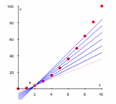

## Let's get ready

```{r setup, include = FALSE}
library(tidyverse) # Add the tidyverse package to my current library.
library(haven) # Handle labelled data.
library(essurvey) # Add ESS API package.
library(ggplot2) # Allows us to create nice figures.
library(estimatr) # Allows us to estimate (cluster-)robust standard errors.
library(texreg) # Allows us to make nicely-formatted Html & Latex regression tables.
library(broom) # Allows us to turn parts of model objects into tibbles.
library(modelr) # Model predictions (can also do resampling).
library(lmtest) # Allows us to estimate (cluster-)robust standard errors for GLMs.
library(sandwich) # Allows us to estimate (cluster-)robust standard errors for GLMs.
library(margins) # Get Average marginal effects.
```

```{r include = FALSE, eval = FALSE}
# Import the ESS round 9 data via the API
ESS <- import_rounds(rounds = 9, ess_email = "merlin.schaeffer@uni-koeln.de", format = "spss")
```

---

```{r eval = FALSE}
ESS <- ESS %>% transmute( # Create new variables and keep only those
  cntry = as_factor(cntry) %>% fct_relevel("Denmark"), # Country of interview
  gndr = as_factor(gndr), # Gender
  facntr = as_factor(facntr), # Father born in cntry
  mocntr = as_factor(mocntr), # Mother born in cntry
  dscrgrp = as_factor(dscrgrp), # Belonging to discriminated group
  dscrrlg = as_factor(dscrrlg), # Discriminated because of religion
  dscrrce = as_factor(dscrrce), # Discriminated because of race
  dscrlng = as_factor(dscrlng), # Discriminated because of language
  dscretn = as_factor(dscretn), # Discriminated because of ethnicity
  discr = case_when(
    dscrgrp == "Yes" & (dscrrlg == "Marked" | dscrrce == "Marked" |
                          dscrlng == "Marked" | dscretn == "Marked") ~ "Yes",
    dscrgrp == "No" | (dscrgrp == "Yes" & dscrrlg != "Marked" & dscrrce != "Marked"
                       & dscrlng != "Marked" & dscretn != "Marked") ~ "No",
    TRUE ~ as.character(NA)) %>% as_factor(), # all others missing, then change to factor
  pspwght = zap_labels(pspwght),
  agea = zap_label(agea),
  eduyrs = case_when( # Education
    eduyrs > 21 ~ 21, # Recode to max 21 years of edu.
    eduyrs < 9 ~ 9, # Recode to min 9 years of edu.
    TRUE ~ zap_labels(eduyrs))) %>% # make it numeric, then
  dplyr::filter(# Keep only respondents of immigrant origin,
    facntr == "No" & mocntr == "No" &
      # filter cases from three countries, then
      (cntry == "Denmark" | cntry == "Sweden" | cntry == "Norway" | cntry == "Germany"))
```

---

```{r eval = FALSE}
ESS <- ESS %>%
  # Make design matrix (i.e., tibble of the vars going into out model)
  dplyr::select(cntry, eduyrs, discr, gndr, agea, pspwght) %>%
  mutate( # Drop unused factor levels
    cntry = fct_drop(cntry),
    gndr = fct_drop(gndr)) %>% # then
  drop_na() # Casewise deletion.
```

---

## Categorical outcomes {.smaller}

Focus on binary outcomes

When we predict a binary outcome, we want to predict $\text{Pr}(y = 1)$, for instance $\text{Pr}(y = \text{Discrimination})$.

::: columns
::: {.column width="50%"}
::: panel-tabset
## Plot
```{r out.width='90%', fig.height = 4, fig.width = 5, echo = FALSE, eval = FALSE}
ggplot(data = ESS) +
  # Make a bar chart.
  geom_bar(aes(x = discr,
               # Show proportion instead of count.
               y = ..prop.., group = 1)) +
  labs(y = "Probability \n (i.e., proportion or relative frequency)",
         x = "Belonging to a group that is discriminated \n based on race, ethnicity, language, or religion") +
  theme_minimal()
```

## Code
```{r fig.show = "hide", echo = TRUE, eval = FALSE}
ggplot(data = ESS) +
  # Make a bar chart.
  geom_bar(aes(x = discr,
               # Show proportion instead of count.
               y = ..prop.., group = 1)) +
  labs(y = "Probability \n (i.e., proportion or relative frequency)",
         x = "Belonging to a group that is discriminated \n based on race, ethnicity, language, or religion") +
  theme_minimal()
```
:::
:::

::: {.column width="50%"}
```{r eval = FALSE}
ESS$discr %>% 
  # Turn into numeric variable, then
  as.numeric() %>% 
  # subtract 1, so that No=0 & Yes=1, then
  -1 %>% 
  # Pr(y = Ethnic Discrimination) =
  mean(na.rm = TRUE) 
```
:::
:::

## Linear probability model (LPM)

::: columns
::: {.column width="30%"}
Using a linear model (and OLS estimation) to predict a binary outcome yields the so-called *Linear Probability Model*. LPMs predict the probability that the outcome equals 1 for each respondent $\hat{\text{Pr}}(y_i = 1)$, given $x_i$.
:::

::: {.column width="70%"}
::: panel-tabset
## Plot
```{r out.width='70%', fig.height = 4, fig.width = 5, echo = FALSE, eval = FALSE}
ggplot(data = ESS, 
       aes(y = (as.numeric(discr) - 1), 
           x = agea)) +
  geom_jitter(aes(size = pspwght), 
              alpha = 1/5, height = 0.05) +
  geom_smooth(aes(weight = pspwght), 
              method = "lm", se = FALSE) +
  theme(legend.position="none") +
  labs(y = "Probability of belonging to a group discriminated \n based on race, ethnicity, language, or religion",
       x = "Age") +
  theme_minimal()
```

## Code
```{r fig.show = "hide", echo = TRUE, eval = FALSE}
ggplot(data = ESS, 
       aes(y = (as.numeric(discr) - 1), 
           x = agea)) +
  geom_jitter(aes(size = pspwght), 
              alpha = 1/5, height = 0.05) +
  geom_smooth(aes(weight = pspwght), 
              method = "lm", se = FALSE) +
  theme(legend.position="none") +
  labs(y = "Probability of belonging to a group discriminated \n based on race, ethnicity, language, or religion",
       x = "Age") +
  theme_minimal()
```
:::
:::
:::

## Linear probability model (LPM)

::: columns
::: {.column width="50%"}
Because errors of an LPM will *always* be heteroscedastic, we need to estimate robust standard errors.
:::

::: {.column width="50%"}
```{r eval = FALSE}
# LPM with heteroscedasticity-robust inference
# Devide Age by ten, so I measure age in ten-year steps.
lpm <- lm_robust(
  formula = (as.numeric(discr) - 1) ~ 
    I(agea / 10), data = ESS, weights = pspwght)
# Give a summary of the LPM results.
screenreg(lpm, include.ci = FALSE)
```
:::
:::

## Multiple predictors

::: columns
::: {.column width="50%"}
```{r LPM2, eval = FALSE, echo = TRUE}
# LPM with heteroscedasticity-robust inference
lpm2 <- lm_robust(
  formula = (as.numeric(discr) - 1) ~ 
    I(agea / 10) + I(eduyrs / 10)
  + gndr + cntry, 
  data = ESS, 
  weights = pspwght)

# Give a summary of both LPM models
screenreg(list(lpm, lpm2), include.ci = FALSE) 
```
:::

::: {.column width="50%"}
```{r ref.label = "LPM2", echo = FALSE, eval = FALSE}
```
:::
:::

## The problem of linear models

::: columns
::: {.column width="30%"}
LPMs may predict outcomes that make no sense! For instance, LPMs may predict probabilities larger than 1, or smaller than 0. $\hat{\text{Pr}}(y_i = 1) > 1$, or $\hat{\text{Pr}}(y_i = 0) < 0$.
:::

::: {.column width="70%"}
::: panel-tabset
## Plot
```{r out.width='70%', fig.height = 4, fig.width = 5, echo = FALSE, eval = FALSE}
ggplot(data = ESS, 
       aes(y = (as.numeric(discr) - 1), 
           x = agea)) +
  geom_hline(yintercept = 0, color = "#901A1E") +
  geom_jitter(aes(size = pspwght), 
              alpha = 1/5, height = 0.05) +
  geom_smooth(aes(weight = pspwght), 
              method = "lm", se = FALSE,
              # draw line beyond observed cases.
              fullrange = TRUE) +
  theme_minimal() +
  theme(legend.position="none") +
  labs(y = "Probability of belonging to a group discriminated \n based on race, ethnicity, language, or religion",
       x = "Age") +
  xlim(c(16, 120)) # Extend range of x-axis.
```

## Code
```{r fig.show = "hide", echo = TRUE, eval = FALSE}
ggplot(data = ESS, 
       aes(y = (as.numeric(discr) - 1), 
           x = agea)) +
  geom_jitter(aes(size = pspwght), 
              alpha = 1/5, height = 0.05) +
  geom_smooth(aes(weight = pspwght), 
              method = "lm", se = FALSE,
              # draw line beyond observed cases.
              fullrange = TRUE) +
  theme_minimal() +
  theme(legend.position="none") +
  labs(y = "Probability of belonging to a group discriminated \n based on race, ethnicity, language, or religion",
       x = "Age") +
  xlim(c(16, 120)) # Extend range of x-axis.
```
:::
:::
:::

## The problem of linear models

::: columns
::: {.column width="50%"}
This may happen particularly, when LPMs become complex (i.e., with many predictor variables). Note, if you only have categorical predictors, an LPM is perfectly valid and does not suffer from any problems [@angristMostlyHarmlessEconometrics2009, Ch. 3.1.4]!
:::

::: {.column width="50%"}
```{r eval = FALSE} 
# Get predicted probabilities based on our second LMP
ESS$discr_lpm <- predict(object = lpm2,
                             newdata = ESS)

# Give summary statistics of the predicted probabilities
# See the minimum predicted probability:
summary(ESS$discr_lpm)
```
:::
:::

. . .

::: columns
::: {.column width="30%"}
For old and low-educated men from Germany, our model predicts negative probabilities to belong to a group that is discriminated based on race, ethnicity, language or religion; what is that supposed to mean?!
:::

::: {.column width="70%"}
```{r eval = FALSE}
# Display the coefficients of lpm2
coef(lpm2)
```
:::
:::

## Generalized linear models (GLM)

The idea of generalized linear models is to stick to a linear model (i.e., $\alpha + \beta x$), but to map/project its results onto the range of the outcome $y_{i}$.

. . .

::: columns
::: {.column width="50%"}
We can achieve this by using so-called *link functions* $g^{-1}$, along with their inverse $g$: 
:::

::: {.column width="50%"}
$$\begin{align*}
y &= g^{-1}(\alpha + \beta x) \\
g(y) &= \alpha + \beta x. 
\end{align*}$$
:::
:::

## GLM for binary outcomes

::: columns
::: {.column width="50%"}

$$\begin{align*}
\text{logit}(y_{i}) &= \alpha + \beta x, \\
y_{i} &= \text{logit}^{-1}(\alpha + \beta x) \\
& = \text{logistic}(\alpha + \beta x) \\
&= \frac{1}{1+e^{-(\alpha + \beta x)}}.
\end{align*}$$

```{r include = FALSE}
logistic <- function(x) {1 / (1 + exp(-x))}
df <- data.frame(x <- -2:2)
df$exp <- exp(-x)
df$logistic <- logistic(x)
knitr::kable(df)
```

::: {.smaller}
| $\alpha + \beta x$  | $e^{(\alpha + \beta x)}$ | $\frac{1}{e^{(\alpha + \beta x)}} \color{gray}{= e^{-(\alpha + \beta x)}}$ | $\frac{1}{1 + e^{(\alpha + \beta x)}}$ | $\frac{1}{1 +e^{-(\alpha + \beta x)}}$ | 
|--------------------:|-------------------------:|-------------------------------------------------------------:|---------------------------------------:|---------------------------------------:|
|        -2           | 0.135                    | 7.389                                                        | 0.881                                  | 0.119                                  | 
|        -1           | 0.368                    | 2.718                                                        | 0.731                                  | 0.269                                  | 
|         0           | 1                        | 1                                                            | 0.5                                    | 0.5                                    | 
|         1           | 2.718                    | 0.368                                                        | 0.269                                  | 0.731                                  | 
|         2           | 7.389                    | 0.135                                                        | 0.119                                  | 0.881                                  |
:::
:::

::: {.column width="50%"}
We need a link function $g^{-1}$ that maps/projects the results of our linear model to the range 0 to 1. One option is the sigmoid (i.e., s-shaped) *logistic* function, with its inverse the *logit* (logged odds):

```{r Logit-fun, out.width='80%', fig.height = 3, fig.width = 4, echo = FALSE}
df <- data.frame(x = rnorm(mean = 0, sd = 1, n = 1000))
x <- df$x
ggplot(data = df, mapping = aes(x = x)) +
  stat_function(fun = logistic, geom = "line") +
  labs(x = expression(alpha + beta * x)) +
  scale_y_continuous(name = expression(over(1, 1+e^-(alpha + beta * x) ))) +
  theme_minimal() + xlim(-6, 6)
```

::: {.note}
Alternatives are the probit or cloglog link functions; results compared to logit hardly ever differ in meaningful ways.
:::
:::
:::

## Logistic regression {.smaller}

Aka the logistic link function

::: {.column width="50%"}


::: {.centered}
::: {.note}
*Source*: [datacamp: Logistic Regression in R Tutorial](https://www.datacamp.com/community/tutorials/logistic-regression-R)
:::
:::
:::

. . .

::: {.column width="50%"}

$$\text{logit}(y_{i}) = \alpha + \beta x$$

1. $\alpha$ and $\beta$ are now measured in logits (logged odds); difficult to interpret!
2. Re-transformed to probabilities, the size of $\beta$ depends on the specific value of $x$!
3.
::: {.note}
Exponentiated $\beta$ (i.e., $e^{\beta}$ ) can be interpreted as odds ratios, or as multiplicative "effect" (i.e., a % increase).
:::
:::

## Logistic regression in R

::: columns
::: {.column width="50%"}
```{r logit, results = FALSE, echo = TRUE, eval = FALSE}
# Estimate Generalzed Linear Model 
log_model <- glm(
  formula = discr ~ I(agea / 10) +
    I(eduyrs / 10) + gndr + cntry,
  data = ESS,
  family = binomial(link = "logit") # with logit link
)

# Give a summary of the LPM vs Logistic results.
screenreg(list(lpm2, log_model), include.ci = FALSE,
          custom.model.names = c("LPM", "Logistic"))
```

Remember, $\alpha$ and $\beta$ are now predicting $\text{logit}(\hat{y_{i}})$. Based on a regression table, we are left with interpreting direction and significance.
:::

::: {.column width="50%"}
```{r ref.label = "logit", echo = FALSE, eval = FALSE}
```
:::
:::

## Weights {.smaller}

Unfortunately, a bit messy to handle

::: columns
::: {.column width="50%"}
```{r Logit3, eval = FALSE, echo = TRUE}
# Estimate weighted Generalzed Linear Model
log_model2 <- glm(
  formula = discr ~ I(agea / 10) +
    I(eduyrs / 10) + gndr + cntry,
  data = ESS,
  family = quasibinomial(link = "logit"),
  weights = pspwght)

# Create an object that contains coefficients 
# and heteroscedasticity-robust inference
log_model2_rob <- lmtest::coeftest(
  log_model2,
  sandwich::vcovHC(log_model2))

# Summary of LPMs, plug in SEs by hand
screenreg(list(log_model, log_model2, log_model2_rob), 
          include.ci = FALSE, 
          custom.model.names = c("Unweighted", "Weighted", 
                                 "Weighted, robust SE"))
```
:::

::: {.column width="50%"}
```{r ref.label = "Logit3", echo = FALSE, eval = FALSE}
```
:::
:::

## LPM vs Logistic Regression

::: columns
::: {.column width="50%"}
```{r eval = FALSE} 
# Get predicted probabilities from our logistic regression
# Note, type = "response", so as not to get logits,
# but probabilities!
ESS$discr_logistic <- predict(
  object = log_model2, newdata = ESS, 
  type = "response")

# Summary statistics of the predicted probabilities
# See the minimum predicted probability:

# LPM
summary(ESS$discr_lpm)

# Logistic regression
summary(ESS$discr_logistic) 
```
:::

::: {.column width="50%"}


::: {.centered}
::: {.note}
*Source*: [www.datacamp.com](https://www.datacamp.com/community/tutorials/logistic-regression-R)
:::
:::
:::
:::

## LPM vs Logistic Regression

::: panel-tabset
## Plot
```{r  out.width='50%', fig.height = 4, fig.width = 5, echo = FALSE, eval = FALSE}
ggplot(data = ESS, 
       aes(y = discr_logistic, x = discr_lpm)) +
  geom_vline(xintercept = 0, color = "#901A1E") + 
  geom_point(alpha = 1/5) +
  geom_smooth(se = FALSE) + 
  theme_minimal() +
  labs(y = "Logistic regression-based \n predicted probability",
       x = "LPM-based \n predicted probability",
       title = "Belonging to a group discriminated \n based on race, ethnicity, language, or religion")
```

## Code
```{r fig.show = "hide", echo = TRUE, eval = FALSE}
ggplot(data = ESS, 
       aes(y = discr_logistic, x = discr_lpm)) +
  geom_vline(xintercept = 0, color = "#901A1E") + 
  geom_point(alpha = 1/5) +
  geom_smooth(se = FALSE) + 
  theme_minimal() +
  labs(y = "Logistic regression-based \n predicted probability",
       x = "LPM-based \n predicted probability",
       title = "Belonging to a group discriminated \n based on race, ethnicity, language, or religion")
```
:::

## Average Marginal Effects (AME)

::: columns
::: {.column width="30%"}
Idea: Get the marginal effect (linear increase) at the logistic curve for every observation (combination of Xs) in the data set. Then calculate the average marginal (linear) effect. Basically gives you coefficients of an LPM but no prediction beyond 0/1.

{width="70%"}

::: {.centered}
::: {.note}
*Source*: [Richard Williams](https://www3.nd.edu/~rwilliam/stats3/Margins02.pdf)
:::
:::
:::

::: {.column width="70%"}
```{r eval = FALSE}
AME_log_model2 <- margins(log_model2, vcov = sandwich::vcovHC(log_model2))
screenreg(list(lpm2, log_model2_rob, AME_log_model2), include.ci = FALSE, 
          custom.model.names = c("LPM", "Logistic", "AME"))
```
:::
:::

## Coefplot

::: columns
::: {.column width="50%"}
```{r coefplot, fig.show = "hide", echo = TRUE, eval = FALSE}
# Turn model results into data
plotdata <- AME_log_model2 %>% # Use model object, then
  tidy() %>% # Turn into tibble, then
  # Keep only some info, then
  dplyr::select(term, estimate, std.error) %>%
  mutate( # get 95% CI and recode name of variables
    min95 = estimate - std.error*qt(0.975, df = nrow(ESS)),
    max95 = estimate + std.error*qt(0.975, df = nrow(ESS)),
    term = fct_recode(factor(term),
                      "Age" = "agea",
                      "Years of education" = "eduyrs",
                      "Women" = "gndrFemale",
                      "Germany" = "cntryGermany",
                      "Norway" = "cntryNorway",
                      "Sweden" = "cntrySweden"))

ggplot(data = plotdata, 
       aes(x = reorder(term, estimate), y = estimate, 
           ymin = min95, ymax = max95)) +
  geom_hline(yintercept = 0, # Null-hypothesis line
             color = "#901A1E", lty = "dashed") + 
  geom_pointrange() + # Coefs with 95% CI.
  coord_flip() + theme_minimal() +
  labs(y = expression(beta), x = "") # Greek beta.
```
:::

::: {.column width="50%"}
```{r ref.label = "coefplot", out.width='100%', fig.height = 4, fig.width = 5, echo = FALSE, eval = FALSE}
```
:::
:::

## Model predictions

::: columns
::: {.column width="50%"}
Step 1: Generate synthetic data.
```{r PredictedProp1, eval = FALSE, echo = TRUE}
(synth_data <- ESS %>%
  # Generate theoretically-informative 
  # and artificial tibble for predictions
  data_grid(agea, eduyrs, gndr, cntry) %>%
  mutate( # Set confounders constant at their mean,
    eduyrs = mean(ESS$eduyrs, na.rm = TRUE),
    cntry = "Denmark", # Or categories of interest
    gndr = "Female") %>% # then
  unique()) # Drop duplicates and missings
```
:::

::: {.column width="50%"}
```{r ref.label = "PredictedProp1", echo = FALSE, eval = FALSE}
```
:::
:::

## Model predictions

::: columns
::: {.column width="50%"}
Step 2: Predict probabilities and 95% CI based on model.
```{r PredictedProp2, eval = FALSE, echo = TRUE}
# Generate predictions and 95% confidence intervals.
(synth_data <- synth_data %>% 
  mutate(
    fit = predict(log_model2, 
                  type = "response", newdata = .),
    fit_se = predict(log_model2, 
                     type = "response", newdata = .,
                     se.fit = TRUE)$se.fit,
    min95 = fit - fit_se * qt(0.975, df = nrow(ESS)),
    max95 = fit + fit_se * qt(0.975, df = nrow(ESS))
  ))
```
:::

::: {.column width="50%"}
```{r ref.label = "PredictedProp2", echo = FALSE, eval = FALSE}
```
:::
:::

## Visualize the model predictions

::: panel-tabset
## Plot
```{r out.width='50%', fig.height = 3.5, fig.width = 5, echo = FALSE, eval = FALSE}
ggplot(data = synth_data, 
       aes(y = fit, x = agea)) +
  geom_ribbon(aes(ymin = min95, ymax = max95), 
              alpha = 0.5) +
  geom_line() +
  labs(x = "Age",
       y = "Probability of belonging to a group \n discriminated based on \n race, ethnicity, language, or religion",
       caption = "(Covariates set to: German Women with mean education)") + 
  theme_minimal()
```

## Code
```{r eval= FALSE, echo = TRUE}
ggplot(data = synth_data, 
       aes(y = fit, x = agea)) +
  geom_ribbon(aes(ymin = min95, ymax = max95), 
              alpha = 0.5) +
  geom_line() +
  labs(x = "Age",
       y = "Probability of belonging to a group \n discriminated based on \n race, ethnicity, language, or religion",
       caption = "(Covariates set to: German Women with mean education)") + 
  theme_minimal()
```
:::

## Interaction effects

::: columns
::: {.column width="50%"}
```{r Logit4, eval = FALSE, echo = TRUE}
# Estimate Generalzed linear model with logit(y)
log_model3 <- glm(formula = discr ~ I(agea / 10) +
                  I(eduyrs / 10)*cntry + gndr,
                family = binomial(link = "logit"),
                data = ESS, weights = pspwght)

# Create an object that contains coefficients 
# and heteroscedasticity-robust inference
log_model3_rob <-  lmtest::coeftest(log_model3, 
                                    vcovHC(log_model3)) 
 
# Summary of LPMs, plug in SEs by hand
screenreg(list(log_model2_rob, log_model3_rob), 
          include.ci = FALSE) # SE for second model
```
:::

::: {.column width="50%"}
```{r ref.label = "Logit4", echo = FALSE, eval = FALSE}
```
:::
:::

## Model predictions

::: columns
::: {.column width="50%"}
```{r Interaction, eval = FALSE, echo = TRUE}
(synth_data <- ESS %>% # Use ESS_minority, then
   # Create synthetic data, then
   data_grid(agea, eduyrs, gndr, cntry) %>% 
   mutate( # Set confounders to a constant value, then
     agea = mean(ESS$agea, na.rm = TRUE),
     gndr = "Female") %>%
   unique() %>% # Drop duplicates, then
   mutate( # Get the predictions
     fit = predict(log_model3, 
                    type = "response", 
                    newdata = .),
     fit_se = predict(log_model3, 
                       type = "response", 
                       newdata = .,
                       se.fit = TRUE)$se.fit,
     min95 = fit - fit_se*qt(0.975, df = nrow(ESS)),
     max95 = fit + fit_se*qt(0.975, df = nrow(ESS))
   ))
```
:::

::: {.column width="50%"}
```{r ref.label = "Interaction", echo = FALSE, eval = FALSE}
```
:::
:::

## Visualize model predictions

::: panel-tabset
## Plot
```{r out.width='50%', fig.height = 4, fig.width = 5, echo = FALSE, eval = FALSE}
ggplot(data = synth_data, 
       aes(y = fit, x = eduyrs)) +
  geom_line(aes(color = cntry)) +
  labs(x = "Years of Education",
  y = "Probability of belonging to a group \n discriminated based on \n race, ethnicity, language, or religion",
  caption = "(Covariates set to: Women at mean age)") + 
  theme_minimal() +
  theme(legend.position="bottom",
        legend.title=element_blank())
```

## Code
```{r fig.show = "hide", echo = TRUE, eval = FALSE}
ggplot(data = synth_data, aes(y = fit, x = eduyrs)) +
  geom_line(aes(color = cntry)) +
  labs(x = "Years of Education",
  y = "Probability of belonging to a group \n discriminated based on \n race, ethnicity, language, or religion",
  caption = "(Covariates set to: Women at mean age)") + 
  theme_minimal() +
  theme(legend.position="bottom",
        legend.title=element_blank())
```
:::

## Visualize model predictions

::: panel-tabset
## Plot
```{r out.width='50%', fig.height = 4, fig.width = 5, echo = FALSE, eval = FALSE}
ggplot(data = synth_data, 
       aes(y = fit, x = eduyrs)) +
  geom_ribbon(aes(ymin = min95, ymax = max95,
                  fill = cntry), alpha = 1/10) +
  geom_line(aes(color = cntry)) +
  labs(x = "Years of Education",
  y = "Probability of belonging to a group \n discriminated based on \n race, ethnicity, language, or religion",
  caption = "(Covariates set to: Women at mean age)") + 
  theme_minimal() +
  theme(legend.position="bottom",
        legend.title=element_blank(),)
```

## Code
```{r fig.show = "hide", echo = TRUE, eval = FALSE}
ggplot(data = synth_data, aes(y = fit, x = eduyrs)) +
  geom_ribbon(aes(ymin = min95, ymax = max95, fill = cntry), alpha = 1/10) +
  geom_line(aes(color = cntry)) +
  labs(x = "Years of Education",
  y = "Probability of belonging to a group \n discriminated based on \n race, ethnicity, language, or religion",
  caption = "(Covariates set to: Women at mean age)") + 
  theme_minimal() +
  theme(legend.position="bottom",
        legend.title=element_blank(),)
```
:::

## Beyond binary outcomes

| Type  | Example | Error distribution | Canonical link | R |
|------|---------|-----|---|---|
| Count | Wage  | Negative Binomial | Neg. Bin. | `MASS::glm.nb()` |
| ..    | ..      | Poisson | log | `glm(family = poisson(link = "log"))`  | 
| ..    | Accidents | Binomial & Neg. Bin. | Neg. Bin. | `pscl::zeroinfl(dist = "negbin")`  | 
| ..    | Waiting time | Gamma | Inverse |  `glm(family=Gamma(link = "inverse")`  | 
| Ordinal | Ratings | Binomial | logit  | `MASS:polr(Hess = TRUE)` |
| Multinominal | Voted party | Binomial | logit | `nnet::multinom()` |

## Today's general lessons

1. Generalized linear models stick to the linear model, but use link functions to map/project results of the linear model to the actual range of the variable.
2. When you estimate a regression model, you can create a table of its main parameters, a figure of its main parameters, but it seems highly advisable to visualize the central relationships you are interested based on that model using model predictions.

## Today's (important) functions

1. `glm()` allows you to estimate a range of generalized linear models. For a logistic regression, make sure to specify `family = binomial(link = "logit")`.
2. `lmtest::coeftest()` together with `sandwich::vcovHC()` allows you to create objects that contain coefficient estimates and heteroscedasticity-robust statistical inference.
3. For some other types of GLM's you need different functions. The most prominently used ones in the social sciences are listed above.

## Literatur

::: {#refs}
:::
