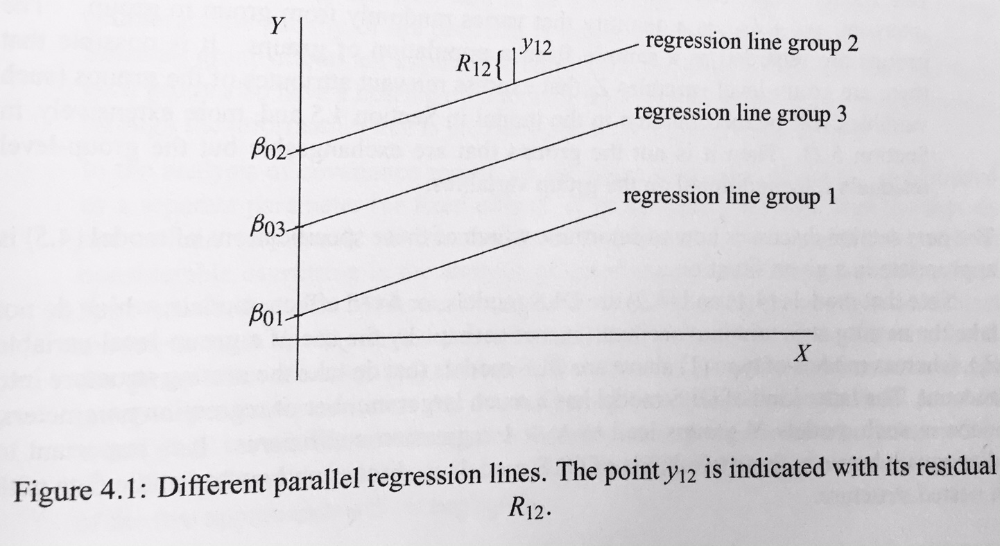
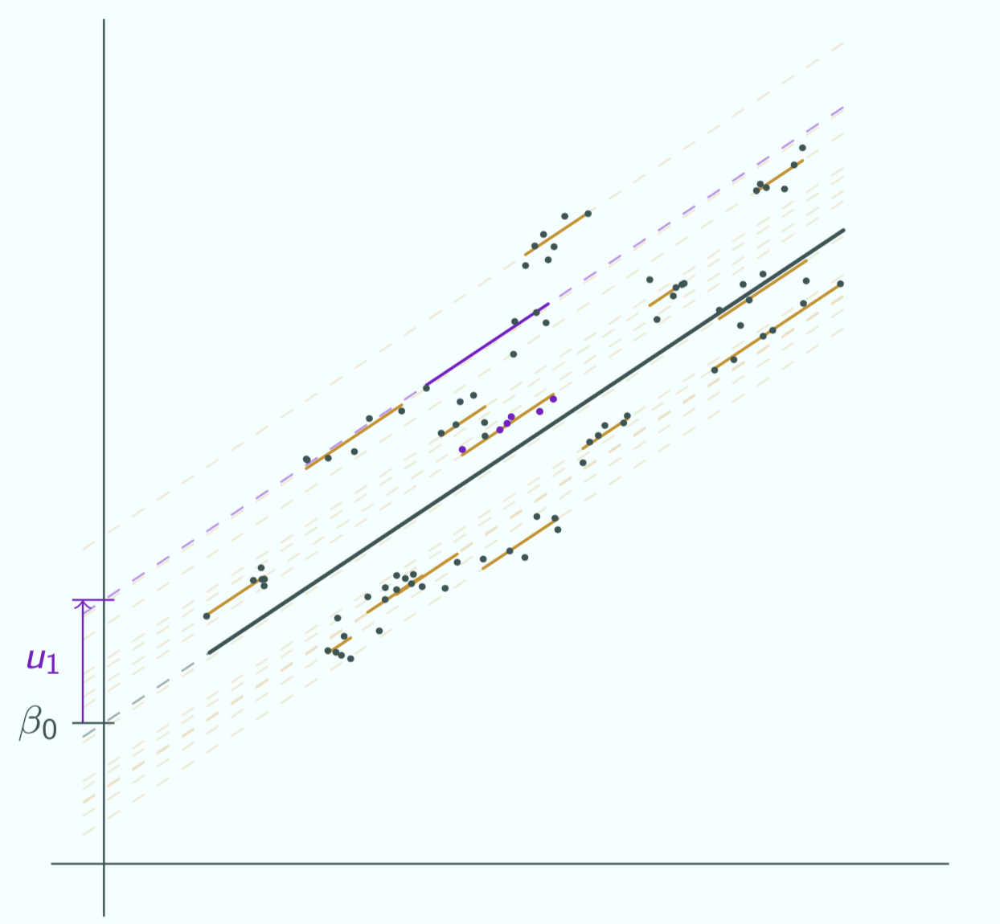
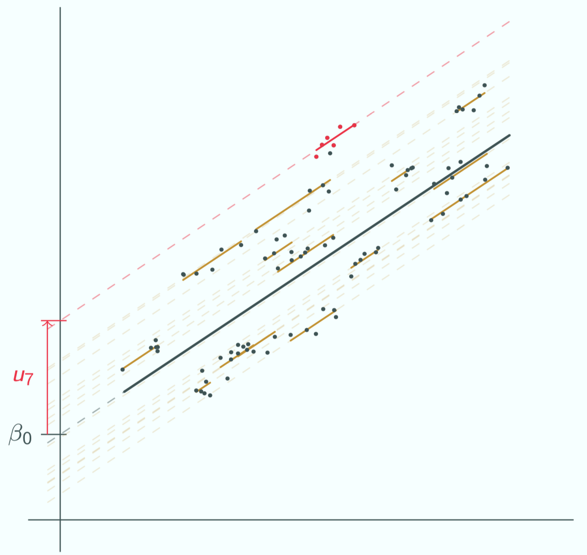

## Let's get ready

```{r setup, include = FALSE}
library(tidyverse) # Add the tidyverse package to my current library.
library(haven) # Handle labelled data.
library(essurvey) # Add ESS API package.
library(ggplot2) # Allows us to create nice figures.
library(estimatr) # Allows us to estimate (cluster-)robust standard errors.
library(texreg) # Allows us to make nicely-formatted Html & Latex regression tables.
library(broom) # Allows us to turn parts of model objects into tibbles.
library(modelr) # Model predictions (can also do resampling).
library(manifestoR) # Add Manifesto API package.
library(lme4) # Allows mixed mulktilevel modeling
library(parameters) # Re-scale weights for mixed multilevel models.
library(merTools) # Prediction intervals for mixed multilevel models.
```

```{r include = FALSE, eval = FALSE}
# Import the ESS round 8 data via the API
ESS <- import_rounds(rounds = 9, ess_email = "merlin.schaeffer@uni-koeln.de", format = "spss")
```

---

```{r eval = FALSE}
ESS <- ESS %>% transmute( # Create new variables and keep only those
    cntry = as_factor(cntry), # Country of interview
    gndr = as_factor(gndr),
    facntr = as_factor(facntr), # Father born in cntry
    mocntr = as_factor(mocntr), # Mother born in cntry
    imbgeco = max(imbgeco, na.rm = TRUE) - zap_labels(imbgeco),
    imueclt = max(imueclt, na.rm = TRUE) - zap_labels(imueclt),
    imwbcnt = max(imwbcnt, na.rm = TRUE) - zap_labels(imwbcnt),
    pspwght = zap_label(pspwght),
    # Parental education (ISCED)
    eiscedf = zap_labels(eiscedf),
    eiscedm = zap_labels(eiscedm),
    par_edu = case_when(
      # If father's edu is missing but not mother's, take mother's
      (eiscedf == 55 | is.na(eiscedf)) & eiscedm != 55 & !is.na(eiscedm) ~ eiscedm,
      # If mother's edu is missing but not father's, take father's
      (eiscedm == 55 | is.na(eiscedm)) & eiscedf != 55 & !is.na(eiscedf)  ~ eiscedf,
      # If both are missing, its missing
      eiscedf == 55 & eiscedm == 55 ~ as.numeric(NA),
      # For all others, take the average of both parents
      TRUE ~ (eiscedm + eiscedf) / 2),
    eduyrs = case_when( # Education
      eduyrs > 21 ~ 21, # Recode to max 21 years of edu.
      eduyrs < 9 ~ 9, # Recode to min 9 years of edu.
      TRUE ~ zap_labels(eduyrs))) %>% # Make it numeric, then
  dplyr::filter(
    facntr == "Yes" & mocntr == "Yes")
```

---

## Re-scaled weights [@snijdersMultilevelAnalysisIntroduction2012, Ch. 14]

```{r eval = FALSE}
# Perform pca of three items and write the results into object xeno.
(xeno <- ESS %>% 
   prcomp(formula = ~ imbgeco + imueclt + imwbcnt, 
          data = ., scale = TRUE, center = TRUE,
          na.action = na.exclude))

# Make a new "xeno" variable and fill it with z-standardized PC1.
ESS$xeno <- -xeno$x[ , "PC1"] %>% # Take PC1 scores, then
  scale() %>% # z-standardize (but sometimes returns a "matrix"), then 
  as.numeric() # turn into numeric vector.

# Design matrix (i.e., tibble of the vars going into out model)
ESS <- ESS %>%
  dplyr::select(cntry, xeno, eduyrs, par_edu, gndr, pspwght) %>%
  mutate(cntry = fct_drop(cntry)) %>% # Drop unused cntry factor levels, then
  drop_na() # Casewise deletion.

# Rescale the post-stratification weight for multilevel modeling
ESS <- rescale_weights(data = ESS, group = "cntry", probability_weights = "pspwght")
```

---

## Within and between variation

::: columns
::: {.column width="30%"}
- We have 29 clusters (groups or macro units) indexed by $j ( = 1, ..., N)$.
- The individuals (micro units) are embedded in these clusters, and indexed by $i ( = 1, ..., n_{j})$.
- Xenophobia is the dependent variable and varies across individuals and clusters: $Y_{ij}$.
:::

::: {.column width="70%"}
```{r WithinBetween, out.width='98%', fig.height = 4, fig.width = 5, echo = FALSE, eval = FALSE}
ESS_aggr <- ESS %>% 
  group_by(cntry) %>%
  summarize(
    xeno_mean = weighted.mean(xeno, w = pweights_a, na.rm = TRUE),
    ) %>% drop_na() 

ESS_aggr <- ESS_aggr %>% left_join(., ESS, by = "cntry") %>% 
  dplyr::select(cntry, xeno_mean, xeno, pspwght) %>%
  bind_rows(., tibble(
    cntry = "Eur. average",
    xeno_mean = weighted.mean(ESS$xeno, w = ESS$pspwght, na.rm = TRUE),
    xeno = xeno_mean)) %>%
  mutate(
    farbe = case_when(
      cntry == "Eur. average" ~ "Betont",
      TRUE ~ "Nicht betont"
    )
  )

ggplot(data = ESS_aggr, aes(y = xeno_mean, x = reorder(cntry, xeno_mean))) +
  geom_jitter(aes(y = xeno, color = cntry), width = 0.25, height = 0.35, alpha = 1/10) +
  scale_color_discrete(guide = FALSE) +
  geom_point(aes(fill = farbe), shape = 21, size = 2.8) +
  scale_fill_manual(guide = FALSE, values = c("#901A1E", "#000000")) +
  labs(y = expression(Xenophobia["ij"]), x = "") +
  guides(size = FALSE) +
  theme_minimal() +
  theme(axis.text.x = element_text(angle = 45))
```
:::
:::

---

```{r eval = FALSE}
# NOTE: original code reads the Manifesto API key from "manifesto_apikey.txt",
# a credentials file that is not distributed with these slides. Left here as
# illustrative-only code; it will not run without your own API key file.
mp_setapikey("manifesto_apikey.txt")
ESS <- mp_maindataset() %>% # Read Manifesto data, then
  dplyr::select(countryname, edate, per601, per602, per607, per608, pervote) %>% # Select vars, then
  mutate(cntry = countryname) %>% # Recode cntry key
  group_by(cntry) %>% # Group the data by country, then
  dplyr::filter(edate == max(edate)) %>% # Use only the most recent pre-2016 manifestos from each country, then
  summarize( # Calculate the average orientations of parites, then
    party_multicult = mean((per607 - per608), na.rm = TRUE),
    party_patriot = mean((per601 - per602),  na.rm = TRUE)
  ) %>% # drop countries with NA on predictors.
   dplyr::filter(!is.na(party_multicult) | !is.na(party_patriot)) %>%
  inner_join(ESS, ., by = "cntry")
```

::: panel-tabset
## Plot
```{r echo = FALSE, fig.height= 4, fig.width = 7, out.width = '40%', eval = FALSE}
ggplot(data = ESS, aes(x = party_multicult, y = party_patriot)) +
  geom_text(aes(label = cntry)) +
  theme_minimal() +
  labs(y = "% Patriotism endorsement", x = "% Multiculturalism endorsement", title = "Average party manifesto")
```

## Code
```{r fig.show = 'hide', eval = FALSE}
ggplot(data = ESS, aes(x = party_multicult, y = party_patriot)) +
  geom_text(aes(label = cntry)) +
  theme_minimal() +
  labs(y = "% Patriotism endorsement", x = "% Multiculturalism endorsement", title = "Average party manifesto")
```
:::

---

## Do party positions [predict how people think about immigration?]{style="font-size:0.6em"}

. . .

::: columns
::: {.column width="50%"}
```{r badOLS, results = FALSE, eval = FALSE}
bad_ols <- lm_robust(xeno ~ eduyrs + par_edu + gndr +
                       party_multicult + party_patriot,
                     data = ESS)

screenreg(bad_ols, include.ci = FALSE, digits = 3)
```

::: {.centered}
**But that would be wrong!**
:::

One of the critical OLS assumptions is the *independence of errors*, after all predictors $x_{ij}$ have been taken into account:

$$\text{Cov}(\epsilon_{i}, \epsilon_{i'} | x_{ij}) = 0$$
Breaching this assumptions does not bias $\beta$ estimates. But it renders them less precise and statistical inference as overoptimistic (i.e., standard errors, confidence intervals, and *p*-values will be too small, and *t*-values too large).
:::

::: {.column width="50%"}
```{r ref.label = "badOLS", echo = FALSE, eval = FALSE}
```
:::
:::

---

## Understanding the problem

::: columns
::: {.column width="50%"}
In this simulated example, it is easily visible that the errors of respondents belonging to the same cluster $j$ are correlated: $\text{Cov}(\epsilon_{ij}, \epsilon_{i'j}|x_{ij}) \neq 0$. In consequence, the conventional OLS standard error will be too small, by a factor of:

$$\tau \simeq 1 + \rho_{x}\rho_{u}(\bar{N_{g}}-1),$$
::: {.note}
where $\rho_{u}$ is the within-cluster error correlation, $\rho_{x}$ is the within-cluster correlation of predictor $x$, and $\bar{N_{g}}$ is the number of observations per cluster [@cameronPractitionerGuideClusterRobust2015].
:::

This means, statistical inference will be increasingly overoptimistic:

1. The more of remaining variation in $y_{ij}$ (i.e., $e_{ij}$ ) varies across clusters.
2. The less a predictor $x_{ij}$ varies within clusters.

::: {.note}
Consider our Manifesto variables: They are country-level characteristics and do not very-within out clusters at all; thus they should be badly affected.
:::
:::

::: {.column width="50%"}
```{r simu_example, out.width='100%', fig.align='center', fig.height = 3.5, fig.width = 5, fig.retina = 3, echo = FALSE}
set.seed(96664) # Allows me to reproduce the same "pseudo-random" outcome.
# Make a tibble called sim-data, containting:
sim_data <- tibble(# A normally distributed var with 1000 obs.
                   education = rnorm(mean = 0, sd = 1, n = 700),
                   e = rnorm(sd = 0.2, n = 700),
                   # A factor that distinguishes 10 types with each 100 obs.
                   Country = factor(c(rep(1:7, each = 100))),
                   # Another normally distributed random var which does not vary within the factor types.
                   u_c = rep(rnorm(0, sd = 1.5, n = 7), each = 100),
                   # Compositional differences in Education between countries
                   comp = rep(rnorm(0, sd = 2, n = 7), each = 100),
                   Education = education + comp
                  )
# Generate outcome as linear function of the other vars.
sim_data <- sim_data %>% mutate(
    Education = Education + abs(min(Education)),
    Xenophobia = 5 + -0.5*Education + u_c + e)

(CLI <- ggplot(data = sim_data, mapping = aes(y = Xenophobia, x = Education, color = Country)) +
  geom_point(alpha = 0.5) +
  geom_smooth(method = "lm", se = FALSE, size =0.4) +
  geom_smooth(method = "lm", se = FALSE, color = "black", size = 1.5) +
  labs(y = expression(Xenophobia["ij"]), 
                      x = expression(Education["ij"])) +
  theme_minimal())
```
:::
:::

---

## Understanding the problem

::: columns
::: {.column width="50%"}
In this simulated example, it is easily visible that the errors of respondents belonging to the same cluster $j$ are correlated: $\text{Cov}(\epsilon_{ij}, \epsilon_{i'j}|x_{ij}) \neq 0$. In consequence, the conventional OLS standard error will be too small, by a factor of:

$$\tau \simeq 1 + \rho_{x}\rho_{u}(\bar{N_{g}}-1),$$
::: {.note}
where $\rho_{u}$ is the within-cluster error correlation, $\rho_{x}$ is the within-cluster correlation of predictor $x$, and $\bar{N_{g}}$ is the number of observations per cluster [@cameronPractitionerGuideClusterRobust2015].
:::

This means, statistical inference will be increasingly overoptimistic:

1. The more of remaining variation in $y_{ij}$ (i.e., $e_{ij}$ ) varies across clusters.
2. The less a predictor $x_{ij}$ varies within clusters.

::: {.note}
Consider our Manifesto variables: They are country-level characteristics and do not very-within out clusters at all; thus they should be badly affected.
:::
:::

::: {.column width="50%"}
```{r out.width='100%', fig.align='center', fig.height = 3.5, fig.width = 5, fig.retina = 3, echo = FALSE}
set.seed(96664) # Allows me to reproduce the same "pseudo-random" outcome.
# Make a tibble called sim-data, containting:
sim_data <- tibble(# A normally distributed var with 1000 obs.
                   education = rnorm(mean = 0, sd = 0.1, n = 700),
                   e = rnorm(sd = 0.1, n = 700),
                   # A factor that distinguishes 10 types with each 100 obs.
                   Country = factor(c(rep(1:7, each = 100))),
                   # Another normally distributed random var which does not vary within the factor types.
                   u_c = rep(rnorm(0, sd = 1.5, n = 7), each = 100),
                   # Compositional differences in Education between countries
                   comp = rep(rnorm(0, sd = 2, n = 7), each = 100),
                   Education = education + comp
                  )
# Generate outcome as linear function of the other vars.
sim_data <- sim_data %>% mutate(
    Education = Education + abs(min(Education)),
    Xenophobia = 5 + -0.5*Education + u_c + e)

(CLI <- ggplot(data = sim_data, mapping = aes(y = Xenophobia, x = Education, color = Country)) +
  geom_point(alpha = 0.5) +
  geom_smooth(method = "lm", se = FALSE, size =0.4) +
  geom_smooth(method = "lm", se = FALSE, color = "black", size = 1.5) +
  labs(y = expression(Xenophobia["ij"]), 
                      x = expression(Education["ij"])) +
  theme_minimal())
```
**Is this an analysis of 700 random individuals, or rather of 7 countries?**
:::
:::

---

## Our ESS data

::: panel-tabset
## Plot
```{r cluster, out.width='35%', fig.height = 6, fig.width = 5, echo = FALSE, eval = FALSE}
ggplot(data = ESS, 
       aes(y = xeno, x = eduyrs)) +
  geom_jitter(aes(color = cntry, size = pspwght), 
              alpha = 1/40) + 
  geom_smooth(aes(color = cntry), method = "lm", 
              se = FALSE, size = 0.7, alpha = 0.7) +
  geom_smooth(method = "lm", se = FALSE, 
              size = 2, color = "black") +
  theme_minimal() + 
  labs(y = expression(Xenophobia["ij"]), 
                      x = expression(Education["ij"])) +
  theme(legend.pos = "bottom") + guides(size = FALSE)
```

## Code
```{r fig.show = "hide", eval = FALSE}
ggplot(data = ESS, aes(y = xeno, x = eduyrs)) +
  geom_jitter(aes(color = cntry, size = pspwght), alpha = 1/40) + 
  geom_smooth(aes(color = cntry), method = "lm", se = FALSE, size = 0.7, alpha = 0.7) +
  geom_smooth(method = "lm", se = FALSE, size = 2, color = "black") +
  theme_minimal() + 
  labs(y = expression(Xenophobia["ij"]), x = expression(Education["ij"])) +
  theme(legend.pos = "bottom") + guides(size = FALSE)
```
:::

---

## Our ESS + Manifesto data

::: panel-tabset
## Plot
```{r out.width='35%', fig.height = 6, fig.width = 5, echo = FALSE, eval = FALSE}
ggplot(data = ESS, 
       aes(y = xeno, x = party_patriot)) +
  geom_jitter(aes(color = cntry, size = pspwght), 
              alpha = 1/40) + 
  geom_smooth(aes(color = cntry), method = "lm", 
              se = FALSE, size = 0.7, alpha = 0.7) +
  geom_smooth(method = "lm", se = FALSE, 
              size = 2, color = "black") +
  labs(y = expression(Xenophobia["ij"]), 
                      x = expression(Patritism["j"])) +
  theme_minimal() + 
  theme(legend.pos = "bottom") + guides(size = FALSE)
```

## Code
```{r fig.show = "hide", eval = FALSE}
ggplot(data = ESS, aes(y = xeno, x = party_patriot)) +
  geom_jitter(aes(color = cntry, size = pspwght), alpha = 1/40) + 
  geom_smooth(aes(color = cntry), method = "lm", se = FALSE, size = 0.7, alpha = 0.7) +
  geom_smooth(method = "lm", se = FALSE, size = 2, color = "black") +
  labs(y = expression(Xenophobia["ij"]), x = expression(Patritism["j"])) +
  theme_minimal() + 
  theme(legend.pos = "bottom") + guides(size = FALSE)
```
:::

---

## Solving the problem [The mixed model solution]{style="font-size:0.6em"}

::: columns
::: {.column width="50%"}
::: {.centered}
*Micro-level model*
:::

We start with a micro-level model, which acknowledges that the intercept varies by cluster:

$$Y_{ij} = \beta_{0 \color{red}{j}} + \beta_{1} x_{1ij} + R_{ij}.$$
::: {.note}
- $\beta_{0j}$ are cluster-differences in the average level of the outcome, adjusted for composition effects of the micro-level predictor(s) $x_{1ij}$.
- $x_{1ij}$ is any micro-level predictor along with it's slope coefficient $\beta_{1}$. $\beta_{1}$ has no subscript $j$, which indicates that $\beta_{1}$ is fixed across clusters.
- $R_{ij}$ are common *random* unexplained residuals, with $R_{ij} = \mathcal{N}(0,\sigma^2)$.
:::
:::

::: {.column width="50%"}
{width="100%"}

::: {.centered}
::: {.note}
*Source*: [@snijdersMultilevelAnalysisIntroduction2012, p. 45]
:::
:::
:::
:::

---

## Solving the problem [The mixed model solution]{style="font-size:0.6em"}

::: columns
::: {.column width="50%"}
::: {.centered}
*Micro-level model*
:::

We start with a micro-level model, which acknowledges that the intercept varies by cluster:

$$Y_{ij} = \beta_{0 \color{red}{j}} + \beta_{1} x_{1ij} + R_{ij}.$$
::: {.note}
- $\beta_{0j}$ are cluster-differences in the average level of the outcome, adjusted for composition effects of the micro-level predictor(s) $x_{1ij}$.
- $x_{1ij}$ is any micro-level predictor along with it's slope coefficient $\beta_{1}$. $\beta_{1}$ has no subscript $j$, which indicates that $\beta_{1}$ is fixed across clusters.
- $R_{ij}$ are common *random* unexplained residuals, with $R_{ij} = \mathcal{N}(0,\sigma^2)$.
:::
:::

::: {.column width="50%"}
```{r ref.label = "cluster", out.width='80%', fig.height = 5, fig.width = 4, echo = FALSE, eval = FALSE}
```
:::
:::

---

## Mixed (random intercept) multilevel models

::: columns
::: {.column width="50%"}
::: {.centered}
*Micro-level model*
:::

We start with a micro-level model, which acknowledges that the intercept varies by cluster:

$$Y_{ij} = \beta_{0 \color{red}{j}} + \beta_{1} x_{1ij} + R_{ij}.$$

::: {.centered}
*Macro-level model*
:::

We continue with a macro-level model that takes the varying intercepts as outcome variable:

$$\beta_{0 \color{red}{j}} = \gamma_{0} + \gamma_{1} z_{1j} + U_{j}.$$
::: {.note}
- $\gamma_{0}$ is the overall mean intercept.
- $z_{1j}$ is a macro-level predictor along with its slope coefficient $\gamma_{01}$. 
- $U_{j}$ are *random* unexplained group residuals, with $U_{j} = \mathcal{N}(0,\tau_{0}^2)$. That is, the cluster-specific deviations from $\gamma_{0}$.
:::
:::

::: {.column width="50%"}
```{r intercept_outcome, out.width='80%', fig.height = 5, fig.width = 4, echo = FALSE, eval = FALSE}
mix <- lmer(xeno ~ eduyrs + (1 | cntry), data = ESS, weight = pweights_a)

dat <- inner_join(
  y = as_tibble(ranef(mix)) %>% mutate(
    cntry = as_factor(grp) %>% fct_drop()),
  x = mp_maindataset() %>% # Read Manifesto data, then
  dplyr::select(countryname, edate, per601, per602, per607, per608, pervote) %>% # Select vars, then
  mutate(cntry = countryname) %>% # Recode cntry key
  group_by(cntry) %>% # Group the data by country, then
  dplyr::filter(edate == max(edate)) %>% # Use only the most recent pre-2016 manifestos from each country, then
  summarize( # Calculate the average orientations of parites, then
    party_multicult = mean((per607 - per608), na.rm = TRUE),
    party_patriot = mean((per601 - per602),  na.rm = TRUE)
  ) %>% # drop countries with NA on predictors.
   dplyr::filter(!is.na(party_multicult) | !is.na(party_patriot)), 
  by = "cntry") %>%
  dplyr::select(condval, cntry, party_patriot)

ggplot(data = dat, 
       aes(y = condval, x = party_patriot)) +
  geom_text(aes(color = cntry), label = expression(beta["0j"])) + 
  geom_smooth(method = "lm", se = FALSE, color = "black") +
  theme_minimal() + 
  labs(y = expression(beta["0j"]), x = expression(Patriotism[j])) +
  theme(legend.pos = "bottom")
```
:::
:::

---

## Mixed (random intercept) multilevel models

::: columns
::: {.column width="50%"}
::: {.centered}
**Random intercept model**
:::

$$Y_{ij} = \underbrace{\gamma_{00} + \gamma_{01} z_{1j} + \gamma_{10} x_{1ij}}_{\text{Fixed part}} + \underbrace{U_{0j} + R_{ij}}_{\text{Random part}}.$$

- *Fixed part*: The slopes of explanatory micro- and macro-level variables and the overall intercept. These are non-varying point estimates and thus called "fixed."
- *Random part*: $U_{0j}$ and $R_{ij}$ are assumed to be normally-distributed random variables that are generated by unmeasured processes. They are leftover macro- and micro-level residuals. As random variables, their concrete values remain latent. We therefore only estimate their variances:
$$\begin{align*}
  \text{var}(U_{0j}|X) &= \tau_{0}^2 \text{ (leftover between-cluster variation)}, \\
  \text{var}(R_{ij}|X) &= \sigma^2 \text{ (leftover within-cluster variation)}.\\
  \end{align*}$$
:::

::: {.column width="50%"}
:::
:::

---

## Mixed (random intercept) multilevel models

::: columns
::: {.column width="50%"}
::: {.centered}
**Random intercept model**
:::

$$Y_{ij} = \underbrace{\gamma_{00} + \gamma_{01} z_{1j} + \gamma_{10} x_{1ij}}_{\text{Fixed part}} + \underbrace{U_{0j} + R_{ij}}_{\text{Random part}}.$$

- *Fixed part*: The slopes of explanatory micro- and macro-level variables and the overall intercept. These are non-varying point estimates and thus called "fixed."
- *Random part*: $U_{0j}$ and $R_{ij}$ are assumed to be normally-distributed random variables that are generated by unmeasured processes. They are leftover macro- and micro-level residuals. As random variables, their concrete values remain latent. We therefore only estimate their variances:
$$\begin{align*}
  \text{var}(U_{0j}|X) &= \tau_{0}^2 \text{ (leftover between-cluster variation)}, \\
  \text{var}(R_{ij}|X) &= \sigma^2 \text{ (leftover within-cluster variation)}.\\
  \end{align*}$$
:::

::: {.column width="50%"}
{width="90%"}

::: {.centered}
::: {.note}
*Source*: [Bristol Centre for Multilevel Modelling](http://www.bristol.ac.uk/cmm/software/support/workshops/materials/multilevel-m.html)
:::
:::
:::
:::

---

## Mixed (random intercept) multilevel models

::: columns
::: {.column width="50%"}
::: {.centered}
**Random intercept model**
:::

$$Y_{ij} = \underbrace{\gamma_{00} + \gamma_{01} z_{1j} + \gamma_{10} x_{1ij}}_{\text{Fixed part}} + \underbrace{U_{0j} + R_{ij}}_{\text{Random part}}.$$

- *Fixed part*: The slopes of explanatory micro- and macro-level variables and the overall intercept. These are non-varying point estimates and thus called "fixed."
- *Random part*: $U_{0j}$ and $R_{ij}$ are assumed to be normally-distributed random variables that are generated by unmeasured processes. They are leftover macro- and micro-level residuals. As random variables, their concrete values remain latent. We therefore only estimate their variances:
$$\begin{align*}
  \text{var}(U_{0j}|X) &= \tau_{0}^2 \text{ (leftover between-cluster variation)}, \\
  \text{var}(R_{ij}|X) &= \sigma^2 \text{ (leftover within-cluster variation)}.\\
  \end{align*}$$
:::

::: {.column width="50%"}
{width="90%"}

::: {.centered}
::: {.note}
*Source*: [Bristol Centre for Multilevel Modelling](http://www.bristol.ac.uk/cmm/software/support/workshops/materials/multilevel-m.html)
:::
:::
:::
:::

---

## Mixed models in R

::: columns
::: {.column width="50%"}
```{r RandInter, eval = FALSE}
# Linear Mixed (random intercept) model
mixed <- lmer(formula = xeno ~ gndr + 
                eduyrs + par_edu +
                party_multicult + party_patriot +
                # The intercept, 1, varies across cntry
                (1 | cntry),
              data = ESS, 
              weights = pweights_a)

screenreg(list(bad_ols, mixed), 
          include.ci = FALSE, digits = 3,
          custom.model.names = c("OLS", "Mixed model"))
```

Coefplots and predictions (see below) work just the same as for common OLS and logistic regression.
:::

::: {.column width="50%"}
```{r ref.label = "RandInter", echo = FALSE, eval = FALSE}
```
:::
:::

---

## Model predictions

::: columns
::: {.column width="50%"}
```{r ModPredictions, eval = FALSE}
(synth_data <- ESS %>% # Use ESS, then
   # reduce complexity to speed up data_grid(), then
   mutate(
     # eduyrs: leave as is, we want to vary it
     par_edu = median(par_edu, na.rm = TRUE),
     party_multicult = 0,
     party_patriot = 0,
     gndr = "Female") %>%
   # Create synthetic data, then
   data_grid(eduyrs, par_edu, gndr, cntry, 
             party_multicult, party_patriot) %>%
   unique() %>% # Drop duplicates, then
   mutate( # Get the predictions
     fit = predict(
       mixed, 
       newdata = .,
       # Predictions by random effect (i.e., cntry)
       re.form = NULL)))
```
:::

::: {.column width="50%"}
```{r ref.label = "ModPredictions", echo = FALSE, eval = FALSE}
```

<!-- Currently, `predict()` does not generate predicted standard errors. So we cannot straight forwardly visualize uncertainty. Apart from that, all else remains the same. -->
:::
:::

---

## Visualize model predictions

::: panel-tabset
## Plot
```{r out.width='45%', fig.height = 5, fig.width = 5, echo = FALSE, eval = FALSE}
ggplot(data = synth_data, 
       aes(y = fit, x = eduyrs)) +
  geom_line(aes(color = cntry)) +
  labs(x = "Years of education",
       y = "Xenophobia",
       caption = "(Covariates set to: Women at median parental education,
       and country minority politics set to non-distinct (i.e., '0'))") + 
  theme_minimal() +
  theme(legend.position="bottom",
        legend.title=element_blank())
```

## Code
```{r fig.show = "hide", eval = FALSE}
ggplot(data = synth_data, 
       aes(y = fit, x = eduyrs)) +
  geom_line(aes(color = cntry)) +
  labs(x = "Years of education",
       y = "Xenophobia",
       caption = "(Covariates set to: Women at median parental education,
       and country minority politics set to non-distinct (i.e., '0'))") + 
  theme_minimal() +
  theme(legend.position="bottom",
        legend.title=element_blank())
```
:::

---

## Model predictions [Contextual predictor]{style="font-size:0.6em"}

::: columns
::: {.column width="50%"}
```{r ModPredictions2, eval = FALSE}
synth_data <- ESS %>% # Use ESS, then
   # reduce complexity to speed up data_grid(), then
   mutate(
     # party_patriot & cntry: leave as is, we want to vary it
     par_edu = median(par_edu, na.rm = TRUE),
     eduyrs = median(eduyrs, na.rm = TRUE),
     party_multicult = 0,
     gndr = "Female") %>%
   # Create synthetic data, then
   data_grid(eduyrs, par_edu, gndr, cntry, 
             party_multicult, party_patriot) %>%
   unique()
 
# Generate predictions and 95% confidence intervals, then
(synth_data <- predictInterval(
  merMod = mixed, newdata = synth_data,
  which = "fixed", level = 0.6, n.sims = 5000,
  include.resid.var = TRUE) %>%
    as_tibble() %>% # Turn into a tibble, then
    bind_cols(synth_data, .)) # Add to the synthetic data.
```
:::

::: {.column width="50%"}
```{r ref.label = "ModPredictions2", echo = FALSE, eval = FALSE}
```
:::
:::

---

## Visualize model predictions

::: panel-tabset
## Plot
```{r out.width='40%', fig.height = 5, fig.width = 6, echo = FALSE, eval = FALSE}
ggplot(data = synth_data, 
       aes(y = fit, x = party_patriot)) +
  geom_ribbon(aes(ymin = lwr, ymax = upr), alpha = 0.5) +
  geom_line() +
  labs(x = "% Patriotism endorsement",
       y = "Xenophobia",
       caption = "(Covariates set to: Women at median (parental) education,
  and country minority politics set to non-distinct (i.e., '0'))") + 
  theme_minimal() +
  theme(legend.position="bottom",
        legend.title=element_blank())
```

## Code
```{r fig.show = "hide", eval = FALSE}
ggplot(data = synth_data, 
       aes(y = fit, x = party_patriot)) +
  geom_ribbon(aes(ymin = lwr, ymax = upr), alpha = 0.5) +
  geom_line() +
  labs(x = "% Patriotism endorsement",
       y = "Xenophobia",
       caption = "(Covariates set to: Women at median (parental) education,
  and country minority politics set to non-distinct (i.e., '0'))") + 
  theme_minimal() +
  theme(legend.position="bottom",
        legend.title=element_blank())
```
:::

---

## Further advanced topics

1. Beware that mixed (random intercept) models don't work perfectly well if you have **less than 30 clusters**. @elffMultilevelAnalysisFew2020 discuss the problems in detail.
2. Interaction effects between a micro-level variable (e.g., education) and a macro-level characteristic are called **cross-level interactions**. They actually requite a more complex type of mixed (random intercept and slope model). @heisigWhyYouShould2019 discuss these models and how to estimate them correctly in detail.

---

## Logistic mixed effects models

The upper-level equation is a simple linear model, but its outcome is $\text{logit}(\alpha_{j})$!

$$\begin{align*}
y_{ij} &= \frac{1}{1 + e^{-(\beta_{0j} + \beta x_{ij})}}, \\
\beta_{0j} &= \gamma_{00} + \gamma_{01} z_{j} + U_{j}, \\
y_{ij} &= \frac{1}{1 + e^{-(\gamma_{00} + \gamma_{01} z_{j} + \gamma_{10} x_{ij} + U_{j})}}.
\end{align*}$$

---

```{r include = FALSE, eval = FALSE}
# Import the ESS round 9 data via the API
ESS_minority <- import_rounds(rounds = 9, ess_email = "merlin.schaeffer@uni-koeln.de", format = "spss")
```

```{r eval = FALSE}
# Use our ESS of immigrants and their descendants
ESS_minority <- ESS_minority %>% transmute( # Create new variables and keep only those
  cntry = as_factor(cntry), # Country of interview
  gndr = as_factor(gndr),
  facntr = as_factor(facntr), # Father born in cntry
  mocntr = as_factor(mocntr), # Mother born in cntry
  dscrgrp = as_factor(dscrgrp), # Belonging to discriminated group 
  dscrrlg = as_factor(dscrrlg), # Discriminated because of religion
  dscrrce = as_factor(dscrrce), # Discriminated because of race
  dscrlng = as_factor(dscrlng), # Discriminated because of language
  dscretn = as_factor(dscretn), # Discriminated because of ethnicity
  discr = case_when(
    dscrgrp == "Yes" & (dscrrlg == "Marked" | dscrrce == "Marked" |
                          dscrlng == "Marked" | dscretn == "Marked") ~ "Yes",
    dscrgrp == "No" | (dscrgrp == "Yes" & dscrrlg != "Marked" & dscrrce != "Marked"
                       & dscrlng != "Marked" & dscretn != "Marked") ~ "No",
    TRUE ~ as.character(NA)) %>% as_factor(), # all others missing, then change to factor
  pspwght = zap_label(pspwght),
  agea = zap_labels(agea),
  eduyrs = case_when( # Education
    eduyrs > 21 ~ 21, # Recode to max 21 years of edu.
    eduyrs < 9 ~ 9, # Recode to min 9 years of edu.
    TRUE ~ zap_labels(eduyrs))) %>% # make it numeric, then
  dplyr::filter(# Keep only respondents of immigrant origin,
    facntr == "No" & mocntr == "No")
```

---

```{r eval = FALSE}
ESS_minority <- ESS_minority %>%
  # Make design matrix (i.e., tibble of the vars going into out model)
  dplyr::select(cntry, eduyrs, discr, gndr, agea, pspwght) %>%
  mutate(cntry = fct_drop(cntry)) %>% # Drop unused cntry factor levels, then
  drop_na() # Casewise deletion.

# Rescale the post-stratification weight for multilevel modeling
ESS_minority <- rescale_weights(data = ESS_minority, group = "cntry", probability_weights = "pspwght")
```

```{r eval = FALSE}
# NOTE: original code reads the Manifesto API key from "manifesto_apikey.txt",
# a credentials file that is not distributed with these slides. Left here as
# illustrative-only code; it will not run without your own API key file.
mp_setapikey("manifesto_apikey.txt")
ESS_minority <- mp_maindataset() %>% # Read Manifesto data, then
  dplyr::select(countryname, edate, per601, per602, per607, per608) %>% # Select vars, then
  mutate(cntry = countryname) %>% # Recode cntry key
  group_by(cntry) %>% # Group the data by country, then
  dplyr::filter(edate == max(edate)) %>% # Use only the most recent pre-2016 manifestos from each country, then
  summarize( # Calculate the average orientations of parites, then
    party_multicult = mean((per607 - per608), na.rm = TRUE),
    party_patriot = mean((per601 - per602),  na.rm = TRUE)
  ) %>% # drop countries with NA on predictors.
   dplyr::filter(!is.na(party_multicult) | !is.na(party_patriot)) %>%
  inner_join(ESS_minority, ., by = "cntry")
```

---

## Logistic mixed models in R

::: columns
::: {.column width="50%"}
```{r LogitML, eval = FALSE}
# Estimate logistic mixed effects 
# (random intercept) model
logit_mixed <- glmer(
  formula = discr ~ agea + eduyrs + gndr + 
    party_multicult + party_patriot +
    # The intercept, 1, varies across cntry
    (1 | cntry),
  data = ESS_minority,
  weights = pweights_a,
  family = binomial(link = "logit"))

screenreg(logit_mixed, include.ci = FALSE, digits = 3)
```
:::

::: {.column width="50%"}
```{r ref.label = "LogitML", echo = FALSE, eval = FALSE}
```
:::
:::

---

## Today's (important) functions

1. `lmer()`: Estimate linear mixed effects (multilevel) regression models.
1. `glmer()`: Estimate generalized (non-)linear mixed effects (multilevel) regression models for binary, count, or other categorical data.

---

## Literatur

::: {#refs}
:::
