## Work flow

```{r setup, include = FALSE}
library(tidyverse)
library(knitr)
```

::: columns
::: {.column width="50%"}
The normal work flow:

1. R script which contains the *R code* that produces,
2. Our R output: *Figures and Tables*,
3. An MS Word document, which is the *report* describing our results.

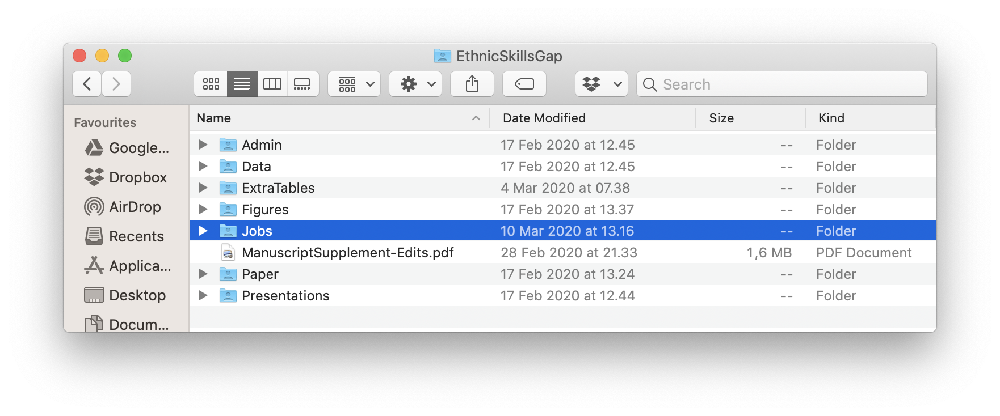{width="100%"}
:::

::: {.column width="50%"}
. . .

**It's disadvantages:**

1. Every time the output changes, we have to revise the Word document.
2. If we comment our R code a lot (as is good practice), we have excessive `#`, and much will be repeated in the 'Data and Methods' section of the Word document.

$\rightarrow$ R Markdown combines R and Markdown to overcome these limitations.
:::
:::

---

## {background-image="https://upload.wikimedia.org/wikipedia/commons/thumb/4/48/Markdown-mark.svg/640px-Markdown-mark.svg.png"}

## MS Word versus Markdown

::: columns
::: {.column width="50%"}
Word is a so-called 'What You See is What You Get' text editor. That is, you edit your text and it looks just like the final *formatted document*.

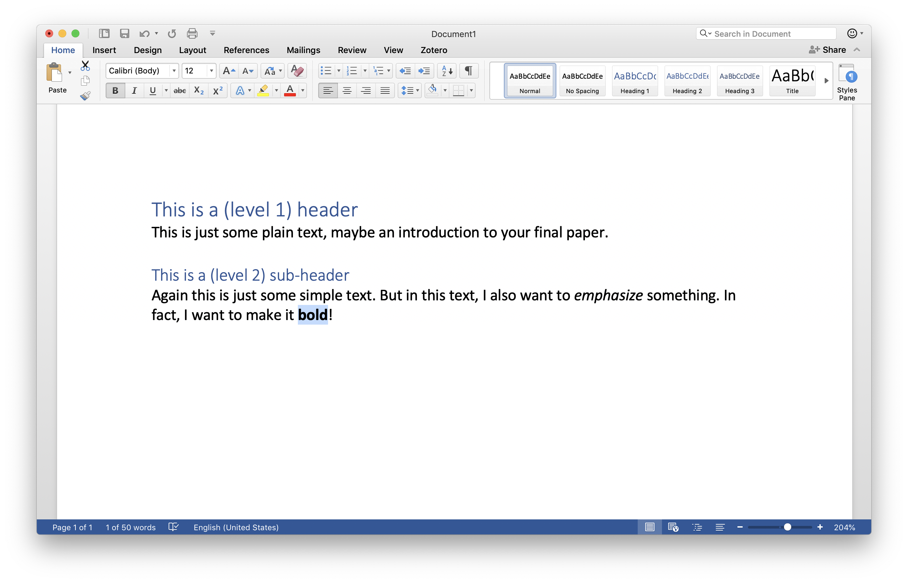{width="100%"}
:::

::: {.column width="50%"}
. . .

Markdown separates text editing in *source files*, from the resulting *formatted output*. The source files contain your text and very simple formatting commands:

```markdown
# This is a (level 1) header
This is just some plain text, maybe an introduction
to your final paper.

## This is a (level 2) sub-header
Again this is just some simple text. But in this text,
I also want to *emphasize* something. In fact, I want
to make it **bold**!

```

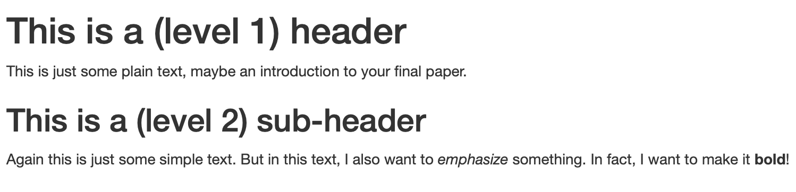{width="100%"}
:::
:::

---

## {background-image="https://bookdown.org/yihui/rmarkdown/images/hex-rmarkdown.png"}

## R Markdown

::: columns
::: {.column width="50%"}
R Markdown allows you to insert *R code chunks* into your Markdown source file:

````markdown
# This is a (level 1) header
This is just some plain text, maybe an introduction
to your final paper.

## This is a (level 2) sub-header
Again this is just some simple text. But in this text,
I also want to *emphasize* something. In fact, I want
to make it **bold**!

And this is some R code:

```r
mean(c(1, 2, 3, NA), na.rm = TRUE)
```
````
:::

::: {.column width="50%"}
. . .

When you turn the source file into a formatted output, the R code will be *evaluated* and with its output, nicely rendered and inserted into your formatted document:

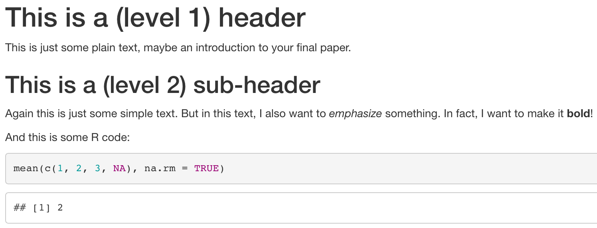{width="100%"}
:::
:::

## Getting started with R Markdown

::: columns
::: {.column width="50%"}
First, open your R Studio project and install 'rmarkdown'.
```r
install.packages("rmarkdown")
```
:::

::: {.column width="50%"}
. . .

::: {.centered}
Then start a new R Markdown document.
:::

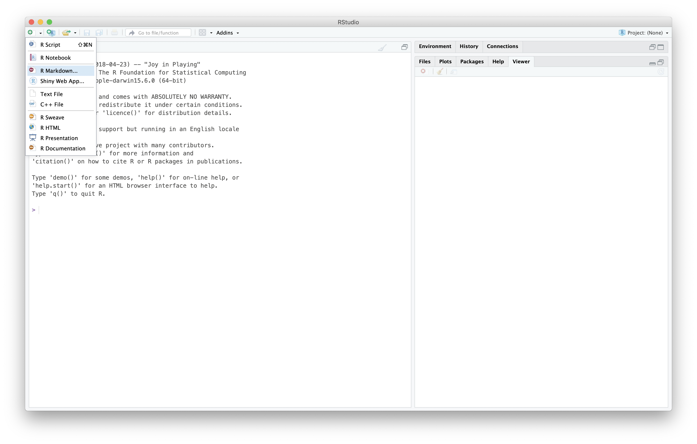{width="100%"}
:::
:::

## Getting started with R Markdown

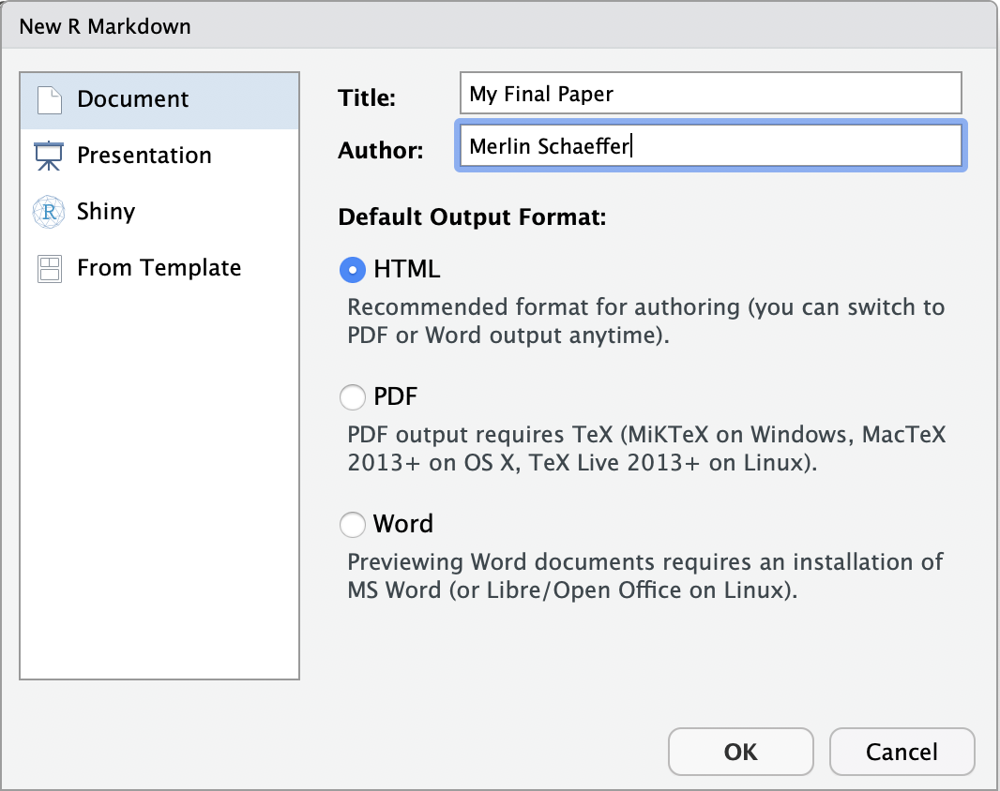{width="50%"}

## Getting started with R Markdown

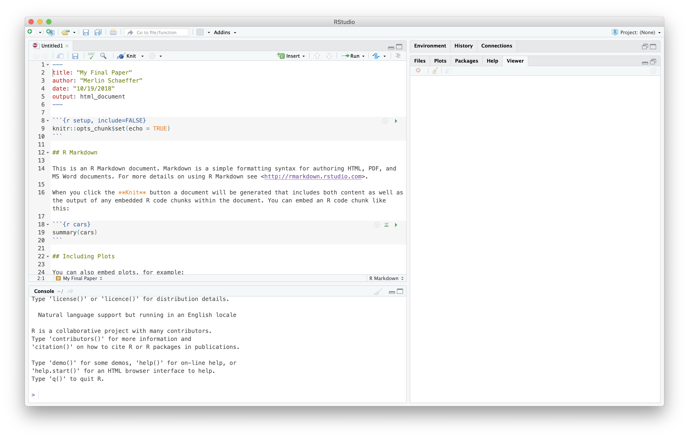{width="80%"}

---

## Klick 'Knit' to compile

::: columns
::: {.column width="50%"}
{width="100%"}
:::

::: {.column width="50%"}
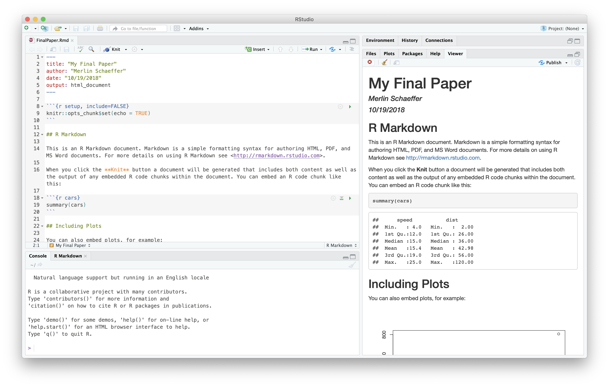{width="100%"}
:::
:::

## What happens in the background

{width="60%"}

## Four remaining topics

1. Markdown formatting commands,
2. R Code chunk options,
3. The YAML header (e.g., how to produce a word file),
4. Citation.

## Markdown formatting commands

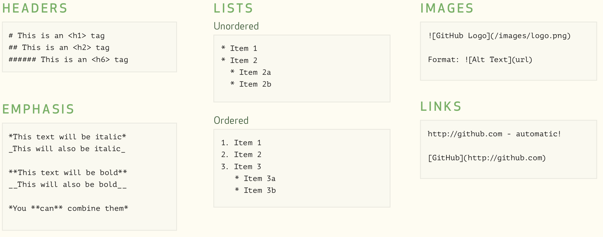{width="100%"}

## Exercise 1 (20 Minutes)

Revise your R Markdown template to a draft of your final paper:

1. Delete the template text.
2. Add a brief intro about the topic of your final paper (see Exam) to the R Markdown document.
3. Give that paragraph the heading "Introduction".
4. Use Markdown code to emphasize what your outcome is.
5. Make a list of some of the the predictor variables you consider to investigate.
6. Mention that you will analyze the ESS and embed a link to the project homepage.
7. Knit it.

## R code chunks

::: columns
::: {.column width="50%"}
You can initiate an R code chunk with $\rightarrow$

Everything between ` ```{r} ` ...  ` ``` ` is evaluated as R code. Moreover, results produced by that R code are pasted into your document.

R output can be customized with [chunk options](http://yihui.name/knitr/options/), which you can add to the initiation:

` ```{r, echo = FALSE, message = FALSE, warning = FALSE} `

- `include = FALSE` prevents code and results from appearing in the final document, although R will evaluate the code.
- `echo = FALSE` prevents code, but not the results from appearing in the finished file.
- `message = FALSE` prevents messages that are generated by code from appearing in the final document.
- `warning = FALSE` prevents warnings that are generated by code from appearing in the final document.
:::

::: {.column width="50%"}
````markdown 
```r

```
P.S.: You should write {r}, not r
````

````markdown 
```{r}
5 + 8
```
P.S.: You should write {r}, not r
````
:::
:::

## Further important R code chunks

::: columns
::: {.column width="50%"}
#### Options for (regression) tables as output:

- `results = 'asis'` prevents Knitr from further processing the R output. This is necessary, for instance, when you generate an html regression table with 'texreg'. Note that this will not work with a Word document as output.
:::

::: {.column width="50%"}
#### Options for figures as output:

- `out.width = "90%"` size of the figure in % of the width of your document.
- `fig.align = "center"` centers the figure in the middle of the document. Alternatives are `"left"` or `"right"`.
- `fig.cap = "This is my beautiful figure"` adds a caption to the figure.
- `dpi = 200` defines pixel resolution of the figure.
- `fig.width = 8` defines the width of the figure in inches.
- `fig.height = 4` defines the height of the figure in inches.
:::
:::

## Exercise 2 (15 Minutes)

Add three R code chunks to your final paper:

1. Add a code chunk that loads the libraries that you are going to use. Make sure that R evaluates the chunk, but that it gives no warnings, no messages, etc..
2. Add a chunk that downloads the ESS data pipes it into a `transmute()` and performs some initial recodings.
3. Add a code chunk that adds a figure (histogram or scatter plot) to your final document.

## The YAML header (Meta data for your document)

::: columns
::: {.column width="50%"}
```yaml
title: My Title
subtitle: My subtitle
author: Merlin Schaeffer
date: "`r Sys.Date()`"
output: html_document
```

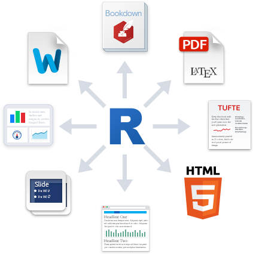{width="70%"}
:::

::: {.column width="50%"}
Among others, the following additional output formats are available:

- `pdf_document` creates a PDF via LaTeX, which you will need to install. RStudio will prompt you if you don’t already have it.

- `word_document` for Microsoft Word documents (.docx).

- `odt_document` for Open Document Text (.odt).

- `rtf_document` for Rich Text Format (.rtf).
:::
:::

## The YAML header (Meta data for your document)

::: columns
::: {.column width="50%"}
```yaml
title: My Title
subtitle: My subtitle
author: Merlin Schaeffer
date: "`r Sys.Date()`"
output: ioslides_presentation
```

{width="70%"}
:::

::: {.column width="50%"}
You might even try out Presentations:

- `ioslides_presentation` makes HTML presentation with ioslides.
- `slidy_presentation` makes HTML presentation with W3C Slidy.
- `beamer_presentation` makes a PDF presentation with LaTeX Beamer (if you have installed Latex).
- `powerpoint_presentation` makes an MS PowerPoint presentation.

`---` defines the beginning of a new slide.

::: {.note}
I personally use [Xaringan](https://bookdown.org/yihui/rmarkdown/xaringan.html) to make these slides.
:::
:::
:::

## Citation

::: columns
::: {.column width="50%"}
If you do not work with any software to manage your literature yet, start using (open source) [Zotero](https://www.zotero.org/)!

{width="100%"}
:::

::: {.column width="50%"}
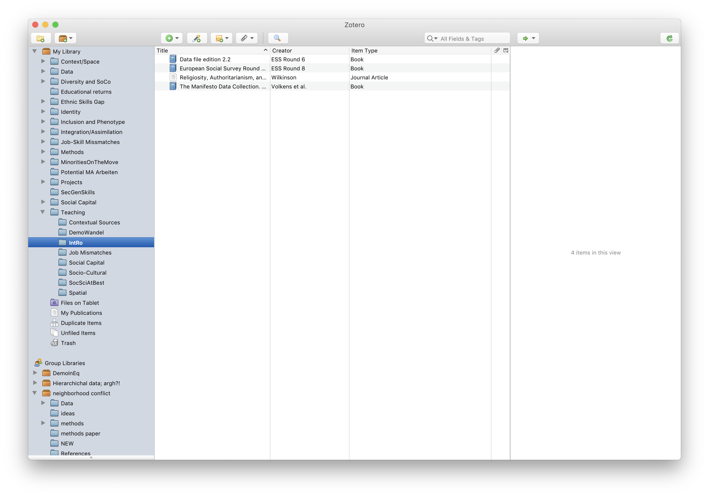{width="100%"}
:::
:::

## Citation (Export your references as 'Bibtex' file)

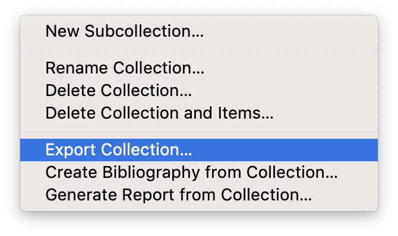{width="40%"}

## Citation (Export your references as 'Bibtex' file)

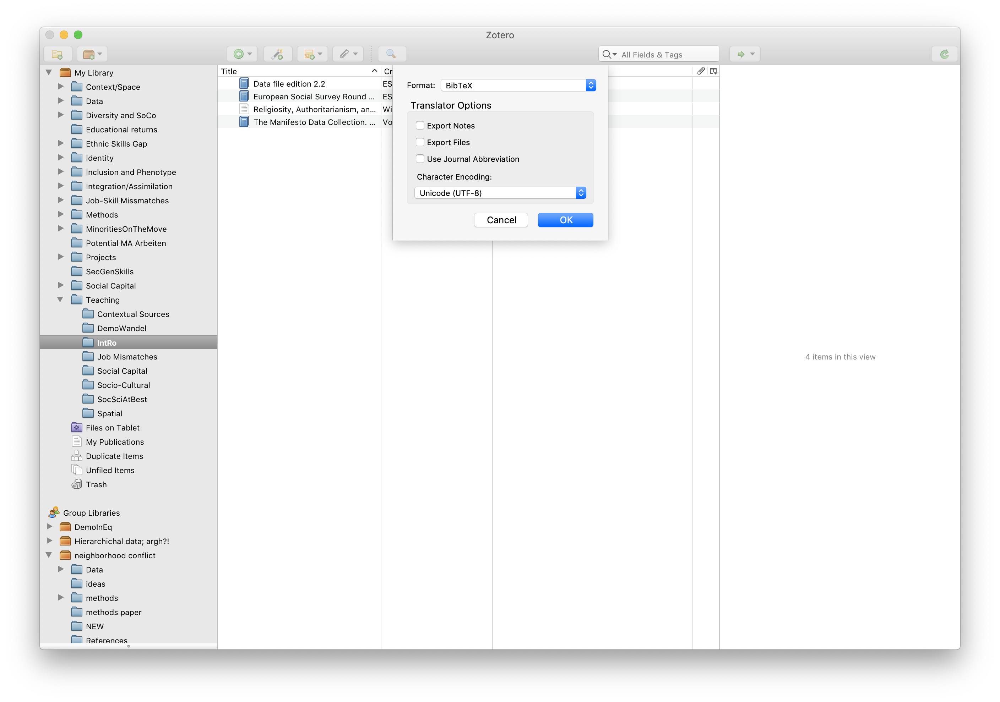{width="70%"}

## Citation (Export your references as 'Bibtex' file)

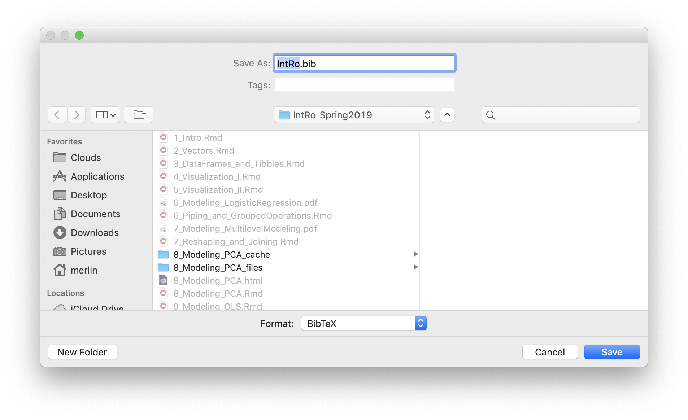{width="50%"}

## Citation (Export your references as 'Bibtex' file)

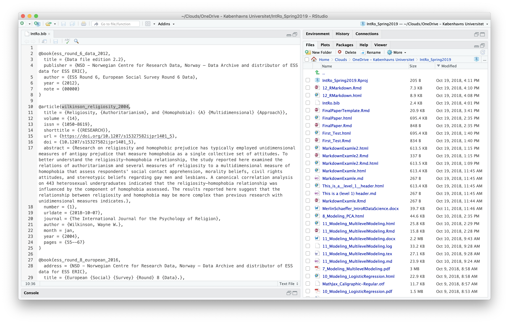{width="75%"}

## In-text citation and list of references

::: columns
::: {.column width="50%"}
Add Bibtex file as bibliography to your YAML header:
```yaml
title: My Title
subtitle: My subtitle
author: Merlin Schaeffer
date: "`r Sys.Date()`"
output: html_document
bibliography: IntRo.bib
```
:::

::: {.column width="50%"}
. . .

Simple in-text citation in R Markdown:

```markdown
This is a claim for which I need a reference 
[@wilkinsonReligiosityAuthoritarianismHomophobia2004]. I continue with my paper.

...

To finally add the list of reference, I simply add:

# References
```

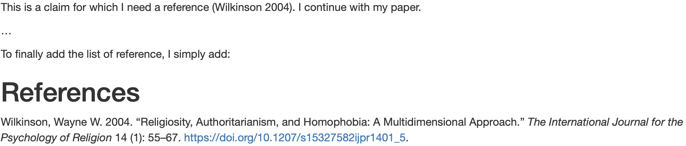{width="100%"}
:::
:::

## Literatur

::: {#refs}
:::

## {background-image="https://mareds.github.io/r_course/img_site/Tidyverse_packages.png"}

. . .

<br>
**Thank you for a fun course!**
